# Bài giảng: Kiến trúc 3 mức ANSI/SPARC — Lược đồ và Tính độc lập dữ liệu

## Tài liệu tham khảo

- Elmasri, R., & Navathe, S. B. — *Fundamentals of Database Systems* (Chapter 2: Database System Concepts and Architecture).
- Silberschatz, A., Korth, H. F., & Sudarshan, S. — *Database System Concepts* (Chapter 1: Storage and Schema Abstraction).
- ANSI/X3/SPARC Study Group on Data Base Management Systems (1975) — *Three-Schema Architecture Framework*.
- GeeksforGeeks – *Data Abstraction and Data Independence in DBMS*.

---

## 1. Mục tiêu học tập

Sau khi hoàn thành bài học này, người học có thể:

1. **Hiểu bản chất kiến trúc 3 mức ANSI/SPARC:** Giải thích được vì sao hệ CSDL cần tách thành ba mức trừu tượng (Internal, Conceptual, External) thay vì lưu trữ đơn lớp như hệ thống tệp.
2. **Phân biệt rành mạch Schema và Instance:** Phân tích được sự khác nhau giữa lược đồ (cấu trúc / định nghĩa) và thể hiện (trạng thái dữ liệu tại một thời điểm).
3. **Hiểu sâu cơ chế ánh xạ (Mapping):** Trình bày vai trò của *Internal–Conceptual Mapping* và *External–Conceptual Mapping*.
4. **Nắm vững tính độc lập dữ liệu (Data Independence):** Phân biệt chính xác *Physical Data Independence* và *Logical Data Independence*; giải thích được vì sao độc lập dữ liệu mức logic khó đạt được hơn mức vật lý.
5. **Nắm vững các mô hình Schema:** Phân biệt và đánh giá ưu/nhược điểm của mô hình Quan hệ (Relational), mô hình phân cấp, mô hình mạng, và mô hình đa chiều (Star / Snowflake Schema trong Data Warehouse).
6. **Ứng dụng vào thực tiễn:** Biết cách thiết kế view tương thích (compatibility layer) khi tái cấu trúc CSDL để không làm hỏng các ứng dụng hiện có.

---

# Phần A. Ba mức trừu tượng dữ liệu (Data Abstraction)

## 2. Data Abstraction là gì?

**Data Abstraction** hay **trừu tượng hóa dữ liệu** là cách DBMS che giấu các chi tiết không cần thiết đối với một người dùng hoặc một ứng dụng, đồng thời chỉ cung cấp phần thông tin phù hợp với nhiệm vụ của họ.

Người dùng đặt hàng trực tuyến thường cần biết:

```text
Tên sản phẩm
Giá bán
Màu sắc
Kích thước
Tình trạng còn hàng
```

Người dùng thường không cần biết:

```text
Dữ liệu được lưu ở file vật lý nào
DBMS dùng index nào để tìm sản phẩm
Dữ liệu nằm ở page/block nào
Có bao nhiêu bản sao dữ liệu
Chiến lược tối ưu truy vấn đang được dùng
```

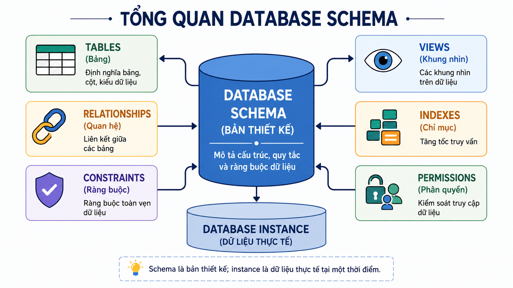
### 2.1. Mục đích

Data Abstraction giúp:

- Đơn giản hóa việc sử dụng dữ liệu.
- Che giấu phần kỹ thuật phức tạp không cần thiết.
- Hỗ trợ thiết kế giao diện dữ liệu khác nhau cho các nhóm vai trò.
- Hạn chế việc hiển thị dữ liệu không liên quan.
- Cho phép DBA và kỹ sư tối ưu hệ thống phía sau mà người dùng không phải biết chi tiết.

> Data Abstraction **hỗ trợ** bảo mật vì có thể giới hạn thông tin hiển thị. Tuy nhiên, bảo mật thực tế vẫn cần xác thực, phân quyền, policy, audit và các cơ chế kiểm soát khác.

---


### Quiz – Data Abstraction là gì?

**Câu 1.** Một sinh viên dùng cổng thông tin để xem điểm nhưng không thể xem cấu trúc index hay vị trí file lưu điểm. Điều này minh họa trực tiếp nhất cho điều gì?

A. External Level chỉ hiển thị thông tin phù hợp, còn chi tiết nội bộ được che giấu.
B. Sinh viên đang quản lý Internal Schema.
C. Mọi người dùng đều có cùng một view dữ liệu.
D. DBMS không có Conceptual Level.

**Câu 2.** Một nhóm cho rằng chỉ cần giấu tên file dữ liệu thì hệ thống đã an toàn. Nhận định nào chính xác nhất?

A. Đúng, vì che giấu file đã thay thế hoàn toàn phân quyền.
B. Chưa đầy đủ; Data Abstraction hỗ trợ giới hạn thông tin hiển thị nhưng cần thêm xác thực, phân quyền và audit.
C. Đúng, vì Data Abstraction tự động ngăn mọi truy cập trái phép.
D. Sai, vì Data Abstraction chỉ liên quan đến màn hình màu sắc.

**Câu 3.** Trong website bán hàng, khách hàng thấy giá và tồn kho nhưng không thấy chiến lược truy cập dữ liệu. Chi tiết nào thuộc phần bị che giấu nhiều nhất?

A. Tên sản phẩm.
B. Màu sắc sản phẩm.
C. Cấu trúc index và access path do DBMS lựa chọn.
D. Giá niêm yết.

## 3. Ba mức trừu tượng dữ liệu

DBMS thường mô tả dữ liệu theo ba mức:

```text
View / External Level
        ↑
Logical / Conceptual Level
        ↑
Physical / Internal Level
```

| Mức | Câu hỏi trọng tâm | Ai thường làm việc? |
|---|---|---|
| View / External | Mỗi nhóm người dùng cần nhìn thấy dữ liệu nào? | End users, application developers, analysts |
| Logical / Conceptual | Toàn bộ dữ liệu được tổ chức logic như thế nào? | Database designers, developers, analysts, DBA |
| Physical / Internal | Dữ liệu thực sự được lưu và truy cập như thế nào? | DBA, system engineers, DBMS engineers |

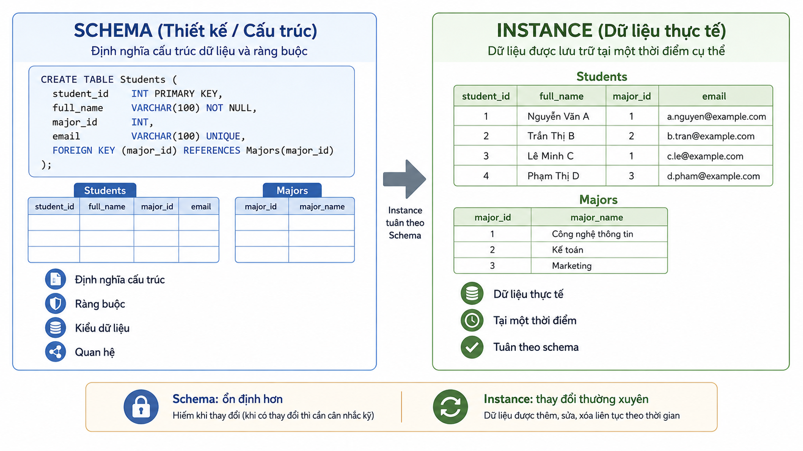

---


### Quiz – Ba mức trừu tượng dữ liệu

**Câu 1.** Một nhà phân tích mô tả những nhóm dữ liệu chính của hệ thống, ý nghĩa của chúng và quan hệ nghiệp vụ giữa chúng, nhưng không bàn về page hoặc index. Họ đang làm việc chủ yếu ở mức nào?

A. External Level.
B. Physical/Internal Level.
C. Network Level.
D. Logical/Conceptual Level.

**Câu 2.** Phát biểu nào ghép đúng câu hỏi với mức dữ liệu?

A. External: người dùng cần thấy gì; Conceptual: dữ liệu được tổ chức logic ra sao.
B. External: dữ liệu lưu ở block nào; Internal: ai được xem dữ liệu nào.
C. Conceptual: index nào được dùng; Internal: dashboard nào được hiển thị.
D. Internal: giao diện API trả về dữ liệu nào; External: dữ liệu được nén ra sao.

**Câu 3.** Một external view thay đổi bố cục báo cáo cho phòng tài chính nhưng không làm thay đổi toàn bộ mô hình dữ liệu. Đây cho thấy điều gì?

A. External Level thay thế Physical Level.
B. Mỗi external view có thể phục vụ nhu cầu riêng mà vẫn dựa trên một conceptual model chung.
C. Mọi báo cáo phải dùng cùng một giao diện.
D. Logical Level chỉ dành cho người dùng cuối.

## 4. Physical / Internal Level

### 4.1. Khái niệm

Physical Level hoặc Internal Level là mức thấp nhất. Nó mô tả cách dữ liệu được lưu trữ và truy cập trong hệ thống.

Ví dụ các chi tiết ở mức này:

```text
Data files
Pages hoặc blocks
Indexes
Access paths
B+ tree hoặc hash structures
Nén dữ liệu
Phân vùng dữ liệu
Sao chép dữ liệu
Vị trí lưu trữ
```

### 4.2. Ví dụ

Khi một người tìm sinh viên theo mã số, họ chỉ yêu cầu hệ thống trả về thông tin sinh viên. DBMS có thể sử dụng index hoặc đọc một số page cụ thể để trả kết quả.

Người dùng không cần biết:

```text
Index có tồn tại hay không
Index dùng cấu trúc nào
Dữ liệu nằm trong file nào
Cần đọc bao nhiêu page
```

### 4.3. Ai quan tâm đến mức này?

- DBA tối ưu hiệu năng và quản lý lưu trữ.
- Kỹ sư hệ thống giám sát tài nguyên.
- DBMS engineers phát triển cơ chế lưu trữ.
- Người dùng cuối thường không làm việc trực tiếp ở mức này.

---


### Quiz – Physical / Internal Level

**Câu 1.** DBA chuyển các data files sang thiết bị lưu trữ mới và tổ chức lại index để cải thiện hiệu năng. Mô tả nào đúng nhất?

A. Đây là thay đổi bắt buộc ở External Level.
B. Đây là thay đổi về nội dung dashboard.
C. Đây là thay đổi chủ yếu ở Physical/Internal Level.
D. Đây là thay đổi trong quyền xem điểm của sinh viên.

**Câu 2.** Vì sao người dùng cuối thường không cần biết DBMS đọc bao nhiêu pages khi tìm một sinh viên?

A. Vì pages chỉ xuất hiện trong Excel.
B. Vì mọi truy vấn chỉ cần đọc đúng một page.
C. Vì database không lưu dữ liệu vật lý.
D. Vì việc chọn access path và đọc pages là chi tiết internal được DBMS che giấu.

**Câu 3.** Một thiết kế cho phép người dùng tự chọn B+ tree hay hash index cho mỗi lần tìm kiếm thông thường là không phù hợp nhất vì lý do nào?

A. Nó buộc người dùng xử lý chi tiết Internal Level thay vì tập trung vào nghiệp vụ.
B. Người dùng không thể nhập dữ liệu.
C. B+ tree không được DBMS hỗ trợ.
D. Hash index luôn chậm hơn mọi cấu trúc khác.

## 5. Logical / Conceptual Level

### 5.1. Khái niệm

Logical Level hoặc Conceptual Level mô tả cấu trúc logic của toàn bộ database.

Nó trả lời các câu hỏi:

```text
Có những thực thể hoặc bảng nào?
Mỗi thực thể có dữ liệu gì?
Các thực thể có quan hệ gì?
Có quy tắc dữ liệu nào?
Thông tin nào cần được lưu?
```

Ví dụ trong hệ thống quản lý sinh viên:

```text
Sinh viên
Môn học
Lớp học phần
Đăng ký học
Điểm
Khoa
Giảng viên
```

Ở mức khái niệm, nhà thiết kế quan tâm đến ý nghĩa và cấu trúc dữ liệu; họ không cần biết bảng đang được lưu trong file nào.

### 5.2. Vai trò

- Là nền tảng để thiết kế database.
- Giúp thống nhất cách hiểu dữ liệu giữa nghiệp vụ và kỹ thuật.
- Cung cấp cấu trúc chung cho nhiều external views.
- Là mức gần nhất với các mô hình ERD và relational schema trong các bài học tiếp theo.

---


### Quiz – Logical / Conceptual Level

**Câu 1.** Một nhóm xác định hệ thống phải quản lý sinh viên, học phần, đăng ký và điểm; sau đó mô tả quan hệ giữa các khái niệm này. Công việc này gần nhất với:

A. Tối ưu page cache.
B. Thiết kế Conceptual Schema.
C. Thiết kế giao diện mobile.
D. Thực hiện backup vật lý.

**Câu 2.** Điều nào không thuộc Logical/Conceptual Level?

A. Các nhóm dữ liệu cần lưu và ý nghĩa nghiệp vụ của chúng.
B. Các quan hệ và quy tắc dữ liệu.
C. Cách DBMS phân bổ dữ liệu trên từng block của ổ đĩa.
D. Cấu trúc tổng thể mà nhiều external views cùng dựa vào.

**Câu 3.** Một báo cáo mới cần xuất hiện cho phòng đào tạo. Báo cáo này nên dựa trực tiếp nhất vào lớp nào để lấy cấu trúc và ý nghĩa dữ liệu thống nhất?

A. Physical Level.
B. Thiết bị lưu trữ.
C. Màn hình của người dùng cuối.
D. Conceptual Level.

## 6. View / External Level

### 6.1. Khái niệm

View Level hoặc External Level là mức gần người dùng nhất. Nó mô tả dữ liệu nào được hiển thị cho một người dùng, một nhóm người dùng hoặc một ứng dụng cụ thể.

Trong một trường đại học:

| Nhóm | Thông tin thường cần |
|---|---|
| Sinh viên | Hồ sơ cá nhân, lịch học, điểm của chính mình |
| Giảng viên | Danh sách lớp, lịch giảng, điểm của lớp phụ trách |
| Phòng đào tạo | Dữ liệu học vụ rộng hơn |
| Phòng tài chính | Học phí, thanh toán, hỗ trợ tài chính |
| DBA | Metadata, quyền, cấu hình và giám sát hệ thống |

### 6.2. External Level không chỉ là SQL VIEW

External Level có thể được hiện thực bằng:

```text
SQL view
Form
Report
Dashboard
API response
Trang web hoặc mobile screen
Export file
Role-based interface
```

SQL `VIEW` là một cơ chế phổ biến, nhưng không phải là toàn bộ ý nghĩa của External Level.

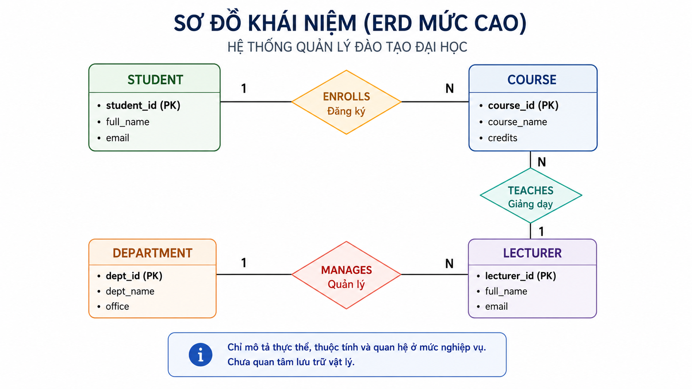

---


### Quiz – View / External Level

**Câu 1.** Một ứng dụng mobile trả về JSON chỉ chứa tên môn học, lịch học và điểm của sinh viên đang đăng nhập. JSON response này có thể được xem là một hiện thực của:

A. External Level.
B. Internal file organization.
C. Physical data page.
D. Index partition.

**Câu 2.** Vì sao không nên đồng nhất hoàn toàn External Level với SQL VIEW?

A. Vì SQL VIEW không thể hiển thị dữ liệu.
B. Vì External Level rộng hơn: có thể được thể hiện qua reports, forms, dashboards, APIs và role-based screens.
C. Vì External Level chỉ dùng cho DBA.
D. Vì SQL VIEW luôn thuộc Physical Level.

**Câu 3.** Trong một trường, phòng tài chính xem học phí nhưng không cần xem điểm chi tiết. Thiết kế hợp lý nhất là:

A. Cấp toàn bộ database cho phòng tài chính để tự lọc.
B. Chuyển toàn bộ dữ liệu sang file Excel.
C. Tạo external interface/view phù hợp với nhiệm vụ và quyền hạn của phòng tài chính.
D. Xóa dữ liệu điểm khỏi conceptual schema.

## 7. Ví dụ xuyên suốt: hệ thống quản lý sinh viên

### 7.1. Physical / Internal

```text
Dữ liệu được lưu trong data files.
DBMS có thể dùng index để tìm nhanh thông tin.
Có thể có backup, replication hoặc partition.
```

### 7.2. Logical / Conceptual

```text
Có các nhóm dữ liệu: sinh viên, môn học, lớp học phần, đăng ký, điểm.
Có các liên hệ và quy tắc nghiệp vụ giữa các nhóm dữ liệu.
```

### 7.3. View / External

```text
Sinh viên xem dữ liệu cá nhân.
Giảng viên xem lớp mình phụ trách.
Phòng đào tạo xem thông tin học vụ.
Phòng tài chính xem dữ liệu học phí.
```

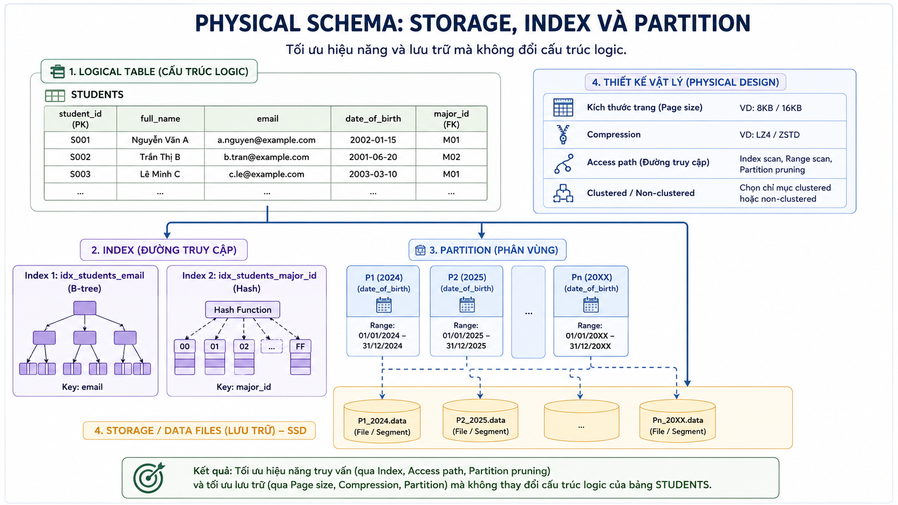

---

## 8. Data Abstraction và Data Independence

Hai khái niệm liên quan nhưng không giống nhau.

| Khái niệm | Câu hỏi trung tâm |
|---|---|
| Data Abstraction | Người dùng hoặc ứng dụng cần nhìn dữ liệu ở mức nào? |
| Data Independence | Khi thay đổi một mức dữ liệu, mức cao hơn hoặc ứng dụng có cần thay đổi đáng kể không? |

Ví dụ:

```text
Sinh viên chỉ xem điểm của mình
→ Data Abstraction / External Level.

DBA thêm index để truy vấn nhanh hơn mà portal sinh viên không cần sửa
→ Physical Data Independence.
```

---

### Quiz – Quiz tổng hợp

**Câu 1.** Một developer nói: “Chúng ta đã có dashboard riêng cho từng phòng ban, vì vậy hệ thống đương nhiên có Data Independence.” Nhận định nào tốt nhất?

A. Đúng hoàn toàn; dashboard tự bảo đảm mọi thay đổi schema không ảnh hưởng application.
B. Sai vì dashboard thuộc Physical Level.
C. Đúng nếu database có ít hơn mười tables.
D. Chưa đủ; dashboard chủ yếu liên quan External Level, còn Data Independence nói về ảnh hưởng của thay đổi giữa các mức.

**Câu 2.** Khi phân tích một hệ thống, thứ tự nào phản ánh đúng từ góc nhìn người dùng đến chi tiết lưu trữ?

A. External → Conceptual → Internal.
B. Physical → External → Conceptual.
C. Conceptual → Physical → External.
D. Internal → External → Conceptual.

**Câu 3.** Một yêu cầu “sinh viên chỉ xem điểm của mình” thuộc loại yêu cầu nào trực tiếp nhất?

A. Yêu cầu thay đổi index vật lý.
B. Yêu cầu về External View và quyền truy cập theo vai trò.
C. Yêu cầu phân vùng ổ đĩa.
D. Yêu cầu thay đổi access path.

**Câu 4.** Một yêu cầu “hệ thống phải có thể đổi cách tổ chức lưu trữ mà portal không cần sửa” liên quan trực tiếp nhất đến:

A. Data Abstraction ở External Level.
B. Thiết kế dashboard.
C. Physical Data Independence.
D. Thiết kế form nhập liệu.

**Câu 5.** Điều nào mô tả đúng nhất mối quan hệ giữa ba mức?

A. Mỗi mức tồn tại độc lập hoàn toàn và không liên quan nhau.
B. Internal Level chỉ mô tả giao diện người dùng.
C. Conceptual Level chỉ mô tả thiết bị phần cứng.
D. External Level mô tả dữ liệu cho vai trò; Conceptual Level mô tả logic chung; Internal Level mô tả lưu trữ/truy cập.

## 10. Bài tập vận dụng

### Bài 10.1. Hệ thống bệnh viện

Một hệ thống bệnh viện có bác sĩ, bệnh nhân, kế toán và quản trị viên.

Hãy nêu:

1. Một external view cho bác sĩ.
2. Một external view cho bệnh nhân.
3. Một loại thông tin ở conceptual level.
4. Hai chi tiết thuộc physical level.

### Bài 10.2. Cổng thương mại điện tử

Đối với một website bán hàng, hãy phân loại các nội dung sau vào Physical, Conceptual hoặc External Level:

```text
Danh mục sản phẩm hiển thị cho khách hàng
Chiến lược index tìm kiếm sản phẩm
Thông tin sản phẩm và đơn hàng cần được quản lý
Dashboard doanh thu cho quản lý
Bản sao dữ liệu dự phòng
```

### Bài 10.3. Nhận xét thiết kế

Một nhóm nói: “Chúng tôi dùng dashboard nên đã có Data Independence.”

Nhận xét phát biểu này bằng 3–5 câu, đồng thời chỉ ra phần nào liên quan đến abstraction và phần nào liên quan đến independence.

---

## 11. Tóm tắt

- Data Abstraction che giấu chi tiết không cần thiết và chỉ hiển thị thông tin phù hợp với từng mục đích.
- DBMS thường có ba mức: Physical/Internal, Logical/Conceptual và View/External.
- Physical Level tập trung vào cách lưu trữ và truy cập dữ liệu.
- Logical Level tập trung vào cấu trúc logic tổng thể của dữ liệu.
- External Level tập trung vào phần dữ liệu từng nhóm người dùng hoặc ứng dụng cần thấy.
- External Level có thể xuất hiện dưới dạng views, forms, reports, dashboards hoặc API responses.
- Data Abstraction không đồng nghĩa hoàn toàn với Data Independence.

## 12. Từ khóa chính

- Data Abstraction
- Internal Level
- Physical Level
- Conceptual Level
- Logical Level
- External Level
- View Level
- External Schema
- Conceptual Schema
- Internal Schema
- Metadata
- Database View
- Role-based Access
- Data Independence


---

# Đáp án quiz

## Đáp án – Data Abstraction là gì?

| Câu | Đáp án | Giải thích |
|---:|:---:|---|
| 2.1 | A | External Level chỉ đưa ra phần dữ liệu cần thiết; các chi tiết kỹ thuật được che giấu. |
| 2.2 | B | Che giấu thông tin không thay thế xác thực, phân quyền hoặc audit. |
| 2.3 | C | Index và access path thuộc chi tiết nội bộ của DBMS. |

## Đáp án – Ba mức trừu tượng dữ liệu

| Câu | Đáp án | Giải thích |
|---:|:---:|---|
| 3.1 | D | Cấu trúc và quan hệ nghiệp vụ của toàn database thuộc Conceptual Level. |
| 3.2 | A | External trả lời người dùng thấy gì; Conceptual trả lời dữ liệu tổ chức logic ra sao. |
| 3.3 | B | Nhiều external views có thể dựa trên cùng một conceptual model. |

## Đáp án – Physical / Internal Level

| Câu | Đáp án | Giải thích |
|---:|:---:|---|
| 4.1 | C | Data files và index là chi tiết internal. |
| 4.2 | D | Page reads và access path do DBMS quản lý ở mức internal. |
| 4.3 | A | Buộc người dùng chọn cấu trúc lưu trữ làm lộ chi tiết không cần thiết. |

## Đáp án – Logical / Conceptual Level

| Câu | Đáp án | Giải thích |
|---:|:---:|---|
| 5.1 | B | Xác định dữ liệu, ý nghĩa và quan hệ là thiết kế conceptual schema. |
| 5.2 | C | Block trên đĩa là chi tiết physical. |
| 5.3 | D | Conceptual Level cung cấp cấu trúc/ý nghĩa chung cho các view. |

## Đáp án – View / External Level

| Câu | Đáp án | Giải thích |
|---:|:---:|---|
| 6.1 | A | API response là một cách biểu hiện external view. |
| 6.2 | B | External Level rộng hơn SQL VIEW. |
| 6.3 | C | Mỗi vai trò nên có interface/view theo nhiệm vụ và quyền hạn. |

## Đáp án – Quiz tổng hợp

| Câu | Đáp án | Giải thích |
|---:|:---:|---|
| 9.1 | D | Dashboard riêng liên quan External Level, không tự bảo đảm independence. |
| 9.2 | A | Thứ tự từ gần người dùng đến gần lưu trữ là External–Conceptual–Internal. |
| 9.3 | B | Đây là yêu cầu external view và access control theo vai trò. |
| 9.4 | C | Đổi cách lưu trữ mà portal không đổi là Physical Data Independence. |
| 9.5 | D | Ba mức có vai trò riêng nhưng liên kết với nhau. |

## 3. Ba mức trừu tượng dữ liệu

DBMS thường mô tả dữ liệu theo ba mức:

```text
View / External Level
        ↑
Logical / Conceptual Level
        ↑
Physical / Internal Level
```

| Mức | Câu hỏi trọng tâm | Ai thường làm việc? |
|---|---|---|
| View / External | Mỗi nhóm người dùng cần nhìn thấy dữ liệu nào? | End users, application developers, analysts |
| Logical / Conceptual | Toàn bộ dữ liệu được tổ chức logic như thế nào? | Database designers, developers, analysts, DBA |
| Physical / Internal | Dữ liệu thực sự được lưu và truy cập như thế nào? | DBA, system engineers, DBMS engineers |


---


### Quiz – Ba mức trừu tượng dữ liệu

**Câu 1.** Một nhà phân tích mô tả những nhóm dữ liệu chính của hệ thống, ý nghĩa của chúng và quan hệ nghiệp vụ giữa chúng, nhưng không bàn về page hoặc index. Họ đang làm việc chủ yếu ở mức nào?

A. External Level.
B. Physical/Internal Level.
C. Network Level.
D. Logical/Conceptual Level.

**Câu 2.** Phát biểu nào ghép đúng câu hỏi với mức dữ liệu?

A. External: người dùng cần thấy gì; Conceptual: dữ liệu được tổ chức logic ra sao.
B. External: dữ liệu lưu ở block nào; Internal: ai được xem dữ liệu nào.
C. Conceptual: index nào được dùng; Internal: dashboard nào được hiển thị.
D. Internal: giao diện API trả về dữ liệu nào; External: dữ liệu được nén ra sao.

**Câu 3.** Một external view thay đổi bố cục báo cáo cho phòng tài chính nhưng không làm thay đổi toàn bộ mô hình dữ liệu. Đây cho thấy điều gì?

A. External Level thay thế Physical Level.
B. Mỗi external view có thể phục vụ nhu cầu riêng mà vẫn dựa trên một conceptual model chung.
C. Mọi báo cáo phải dùng cùng một giao diện.
D. Logical Level chỉ dành cho người dùng cuối.

## 4. Physical / Internal Level

### 4.1. Khái niệm

Physical Level hoặc Internal Level là mức thấp nhất. Nó mô tả cách dữ liệu được lưu trữ và truy cập trong hệ thống.

Ví dụ các chi tiết ở mức này:

```text
Data files
Pages hoặc blocks
Indexes
Access paths
B+ tree hoặc hash structures
Nén dữ liệu
Phân vùng dữ liệu
Sao chép dữ liệu
Vị trí lưu trữ
```

### 4.2. Ví dụ

Khi một người tìm sinh viên theo mã số, họ chỉ yêu cầu hệ thống trả về thông tin sinh viên. DBMS có thể sử dụng index hoặc đọc một số page cụ thể để trả kết quả.

Người dùng không cần biết:

```text
Index có tồn tại hay không
Index dùng cấu trúc nào
Dữ liệu nằm trong file nào
Cần đọc bao nhiêu page
```

### 4.3. Ai quan tâm đến mức này?

- DBA tối ưu hiệu năng và quản lý lưu trữ.
- Kỹ sư hệ thống giám sát tài nguyên.
- DBMS engineers phát triển cơ chế lưu trữ.
- Người dùng cuối thường không làm việc trực tiếp ở mức này.

---


### Quiz – Physical / Internal Level

**Câu 1.** DBA chuyển các data files sang thiết bị lưu trữ mới và tổ chức lại index để cải thiện hiệu năng. Mô tả nào đúng nhất?

A. Đây là thay đổi bắt buộc ở External Level.
B. Đây là thay đổi về nội dung dashboard.
C. Đây là thay đổi chủ yếu ở Physical/Internal Level.
D. Đây là thay đổi trong quyền xem điểm của sinh viên.

**Câu 2.** Vì sao người dùng cuối thường không cần biết DBMS đọc bao nhiêu pages khi tìm một sinh viên?

A. Vì pages chỉ xuất hiện trong Excel.
B. Vì mọi truy vấn chỉ cần đọc đúng một page.
C. Vì database không lưu dữ liệu vật lý.
D. Vì việc chọn access path và đọc pages là chi tiết internal được DBMS che giấu.

**Câu 3.** Một thiết kế cho phép người dùng tự chọn B+ tree hay hash index cho mỗi lần tìm kiếm thông thường là không phù hợp nhất vì lý do nào?

A. Nó buộc người dùng xử lý chi tiết Internal Level thay vì tập trung vào nghiệp vụ.
B. Người dùng không thể nhập dữ liệu.
C. B+ tree không được DBMS hỗ trợ.
D. Hash index luôn chậm hơn mọi cấu trúc khác.

## 5. Logical / Conceptual Level

### 5.1. Khái niệm

Logical Level hoặc Conceptual Level mô tả cấu trúc logic của toàn bộ database.

Nó trả lời các câu hỏi:

```text
Có những thực thể hoặc bảng nào?
Mỗi thực thể có dữ liệu gì?
Các thực thể có quan hệ gì?
Có quy tắc dữ liệu nào?
Thông tin nào cần được lưu?
```

Ví dụ trong hệ thống quản lý sinh viên:

```text
Sinh viên
Môn học
Lớp học phần
Đăng ký học
Điểm
Khoa
Giảng viên
```

Ở mức khái niệm, nhà thiết kế quan tâm đến ý nghĩa và cấu trúc dữ liệu; họ không cần biết bảng đang được lưu trong file nào.

### 5.2. Vai trò

- Là nền tảng để thiết kế database.
- Giúp thống nhất cách hiểu dữ liệu giữa nghiệp vụ và kỹ thuật.
- Cung cấp cấu trúc chung cho nhiều external views.
- Là mức gần nhất với các mô hình ERD và relational schema trong các bài học tiếp theo.

---


### Quiz – Logical / Conceptual Level

**Câu 1.** Một nhóm xác định hệ thống phải quản lý sinh viên, học phần, đăng ký và điểm; sau đó mô tả quan hệ giữa các khái niệm này. Công việc này gần nhất với:

A. Tối ưu page cache.
B. Thiết kế Conceptual Schema.
C. Thiết kế giao diện mobile.
D. Thực hiện backup vật lý.

**Câu 2.** Điều nào không thuộc Logical/Conceptual Level?

A. Các nhóm dữ liệu cần lưu và ý nghĩa nghiệp vụ của chúng.
B. Các quan hệ và quy tắc dữ liệu.
C. Cách DBMS phân bổ dữ liệu trên từng block của ổ đĩa.
D. Cấu trúc tổng thể mà nhiều external views cùng dựa vào.

**Câu 3.** Một báo cáo mới cần xuất hiện cho phòng đào tạo. Báo cáo này nên dựa trực tiếp nhất vào lớp nào để lấy cấu trúc và ý nghĩa dữ liệu thống nhất?

A. Physical Level.
B. Thiết bị lưu trữ.
C. Màn hình của người dùng cuối.
D. Conceptual Level.

## 6. View / External Level

### 6.1. Khái niệm

View Level hoặc External Level là mức gần người dùng nhất. Nó mô tả dữ liệu nào được hiển thị cho một người dùng, một nhóm người dùng hoặc một ứng dụng cụ thể.

Trong một trường đại học:

| Nhóm | Thông tin thường cần |
|---|---|
| Sinh viên | Hồ sơ cá nhân, lịch học, điểm của chính mình |
| Giảng viên | Danh sách lớp, lịch giảng, điểm của lớp phụ trách |
| Phòng đào tạo | Dữ liệu học vụ rộng hơn |
| Phòng tài chính | Học phí, thanh toán, hỗ trợ tài chính |
| DBA | Metadata, quyền, cấu hình và giám sát hệ thống |

### 6.2. External Level không chỉ là SQL VIEW

External Level có thể được hiện thực bằng:

```text
SQL view
Form
Report
Dashboard
API response
Trang web hoặc mobile screen
Export file
Role-based interface
```

SQL `VIEW` là một cơ chế phổ biến, nhưng không phải là toàn bộ ý nghĩa của External Level.


---


### Quiz – View / External Level

**Câu 1.** Một ứng dụng mobile trả về JSON chỉ chứa tên môn học, lịch học và điểm của sinh viên đang đăng nhập. JSON response này có thể được xem là một hiện thực của:

A. External Level.
B. Internal file organization.
C. Physical data page.
D. Index partition.

**Câu 2.** Vì sao không nên đồng nhất hoàn toàn External Level với SQL VIEW?

A. Vì SQL VIEW không thể hiển thị dữ liệu.
B. Vì External Level rộng hơn: có thể được thể hiện qua reports, forms, dashboards, APIs và role-based screens.
C. Vì External Level chỉ dùng cho DBA.
D. Vì SQL VIEW luôn thuộc Physical Level.

**Câu 3.** Trong một trường, phòng tài chính xem học phí nhưng không cần xem điểm chi tiết. Thiết kế hợp lý nhất là:

A. Cấp toàn bộ database cho phòng tài chính để tự lọc.
B. Chuyển toàn bộ dữ liệu sang file Excel.
C. Tạo external interface/view phù hợp với nhiệm vụ và quyền hạn của phòng tài chính.
D. Xóa dữ liệu điểm khỏi conceptual schema.

## 7. Ví dụ xuyên suốt: hệ thống quản lý sinh viên

### 7.1. Physical / Internal

```text
Dữ liệu được lưu trong data files.
DBMS có thể dùng index để tìm nhanh thông tin.
Có thể có backup, replication hoặc partition.
```

### 7.2. Logical / Conceptual

```text
Có các nhóm dữ liệu: sinh viên, môn học, lớp học phần, đăng ký, điểm.
Có các liên hệ và quy tắc nghiệp vụ giữa các nhóm dữ liệu.
```

### 7.3. View / External

```text
Sinh viên xem dữ liệu cá nhân.
Giảng viên xem lớp mình phụ trách.
Phòng đào tạo xem thông tin học vụ.
Phòng tài chính xem dữ liệu học phí.
```


---

## 8. Data Abstraction và Data Independence

Hai khái niệm liên quan nhưng không giống nhau.

| Khái niệm | Câu hỏi trung tâm |
|---|---|
| Data Abstraction | Người dùng hoặc ứng dụng cần nhìn dữ liệu ở mức nào? |
| Data Independence | Khi thay đổi một mức dữ liệu, mức cao hơn hoặc ứng dụng có cần thay đổi đáng kể không? |

Ví dụ:

```text
Sinh viên chỉ xem điểm của mình
→ Data Abstraction / External Level.

DBA thêm index để truy vấn nhanh hơn mà portal sinh viên không cần sửa
→ Physical Data Independence.
```

---

### Quiz – Quiz tổng hợp

**Câu 1.** Một developer nói: “Chúng ta đã có dashboard riêng cho từng phòng ban, vì vậy hệ thống đương nhiên có Data Independence.” Nhận định nào tốt nhất?

A. Đúng hoàn toàn; dashboard tự bảo đảm mọi thay đổi schema không ảnh hưởng application.
B. Sai vì dashboard thuộc Physical Level.
C. Đúng nếu database có ít hơn mười tables.
D. Chưa đủ; dashboard chủ yếu liên quan External Level, còn Data Independence nói về ảnh hưởng của thay đổi giữa các mức.

**Câu 2.** Khi phân tích một hệ thống, thứ tự nào phản ánh đúng từ góc nhìn người dùng đến chi tiết lưu trữ?

A. External → Conceptual → Internal.
B. Physical → External → Conceptual.
C. Conceptual → Physical → External.
D. Internal → External → Conceptual.

**Câu 3.** Một yêu cầu “sinh viên chỉ xem điểm của mình” thuộc loại yêu cầu nào trực tiếp nhất?

A. Yêu cầu thay đổi index vật lý.
B. Yêu cầu về External View và quyền truy cập theo vai trò.
C. Yêu cầu phân vùng ổ đĩa.
D. Yêu cầu thay đổi access path.

**Câu 4.** Một yêu cầu “hệ thống phải có thể đổi cách tổ chức lưu trữ mà portal không cần sửa” liên quan trực tiếp nhất đến:

A. Data Abstraction ở External Level.
B. Thiết kế dashboard.
C. Physical Data Independence.
D. Thiết kế form nhập liệu.

**Câu 5.** Điều nào mô tả đúng nhất mối quan hệ giữa ba mức?

A. Mỗi mức tồn tại độc lập hoàn toàn và không liên quan nhau.
B. Internal Level chỉ mô tả giao diện người dùng.
C. Conceptual Level chỉ mô tả thiết bị phần cứng.
D. External Level mô tả dữ liệu cho vai trò; Conceptual Level mô tả logic chung; Internal Level mô tả lưu trữ/truy cập.

## 10. Bài tập vận dụng

### Bài 10.1. Hệ thống bệnh viện

Một hệ thống bệnh viện có bác sĩ, bệnh nhân, kế toán và quản trị viên.

Hãy nêu:

1. Một external view cho bác sĩ.
2. Một external view cho bệnh nhân.
3. Một loại thông tin ở conceptual level.
4. Hai chi tiết thuộc physical level.

### Bài 10.2. Cổng thương mại điện tử

Đối với một website bán hàng, hãy phân loại các nội dung sau vào Physical, Conceptual hoặc External Level:

```text
Danh mục sản phẩm hiển thị cho khách hàng
Chiến lược index tìm kiếm sản phẩm
Thông tin sản phẩm và đơn hàng cần được quản lý
Dashboard doanh thu cho quản lý
Bản sao dữ liệu dự phòng
```

### Bài 10.3. Nhận xét thiết kế

Một nhóm nói: “Chúng tôi dùng dashboard nên đã có Data Independence.”

Nhận xét phát biểu này bằng 3–5 câu, đồng thời chỉ ra phần nào liên quan đến abstraction và phần nào liên quan đến independence.

---

## 11. Tóm tắt

- Data Abstraction che giấu chi tiết không cần thiết và chỉ hiển thị thông tin phù hợp với từng mục đích.
- DBMS thường có ba mức: Physical/Internal, Logical/Conceptual và View/External.
- Physical Level tập trung vào cách lưu trữ và truy cập dữ liệu.
- Logical Level tập trung vào cấu trúc logic tổng thể của dữ liệu.
- External Level tập trung vào phần dữ liệu từng nhóm người dùng hoặc ứng dụng cần thấy.
- External Level có thể xuất hiện dưới dạng views, forms, reports, dashboards hoặc API responses.
- Data Abstraction không đồng nghĩa hoàn toàn với Data Independence.

## 12. Từ khóa chính

- Data Abstraction
- Internal Level
- Physical Level
- Conceptual Level
- Logical Level
- External Level
- View Level
- External Schema
- Conceptual Schema
- Internal Schema
- Metadata
- Database View
- Role-based Access
- Data Independence


---

# Đáp án quiz

## Đáp án – Data Abstraction là gì?

| Câu | Đáp án | Giải thích |
|---:|:---:|---|
| 2.1 | A | External Level chỉ đưa ra phần dữ liệu cần thiết; các chi tiết kỹ thuật được che giấu. |
| 2.2 | B | Che giấu thông tin không thay thế xác thực, phân quyền hoặc audit. |
| 2.3 | C | Index và access path thuộc chi tiết nội bộ của DBMS. |

## Đáp án – Ba mức trừu tượng dữ liệu

| Câu | Đáp án | Giải thích |
|---:|:---:|---|
| 3.1 | D | Cấu trúc và quan hệ nghiệp vụ của toàn database thuộc Conceptual Level. |
| 3.2 | A | External trả lời người dùng thấy gì; Conceptual trả lời dữ liệu tổ chức logic ra sao. |
| 3.3 | B | Nhiều external views có thể dựa trên cùng một conceptual model. |

## Đáp án – Physical / Internal Level

| Câu | Đáp án | Giải thích |
|---:|:---:|---|
| 4.1 | C | Data files và index là chi tiết internal. |
| 4.2 | D | Page reads và access path do DBMS quản lý ở mức internal. |
| 4.3 | A | Buộc người dùng chọn cấu trúc lưu trữ làm lộ chi tiết không cần thiết. |

## Đáp án – Logical / Conceptual Level

| Câu | Đáp án | Giải thích |
|---:|:---:|---|
| 5.1 | B | Xác định dữ liệu, ý nghĩa và quan hệ là thiết kế conceptual schema. |
| 5.2 | C | Block trên đĩa là chi tiết physical. |
| 5.3 | D | Conceptual Level cung cấp cấu trúc/ý nghĩa chung cho các view. |

## Đáp án – View / External Level

| Câu | Đáp án | Giải thích |
|---:|:---:|---|
| 6.1 | A | API response là một cách biểu hiện external view. |
| 6.2 | B | External Level rộng hơn SQL VIEW. |
| 6.3 | C | Mỗi vai trò nên có interface/view theo nhiệm vụ và quyền hạn. |

## Đáp án – Quiz tổng hợp

| Câu | Đáp án | Giải thích |
|---:|:---:|---|
| 9.1 | D | Dashboard riêng liên quan External Level, không tự bảo đảm independence. |
| 9.2 | A | Thứ tự từ gần người dùng đến gần lưu trữ là External–Conceptual–Internal. |
| 9.3 | B | Đây là yêu cầu external view và access control theo vai trò. |
| 9.4 | C | Đổi cách lưu trữ mà portal không đổi là Physical Data Independence. |
| 9.5 | D | Ba mức có vai trò riêng nhưng liên kết với nhau. |


---

# Phần B. Lược đồ (Database Schema) và Thể hiện (Database Instance)

## 2. Database Schema là gì?

**Database schema** là bản thiết kế mô tả cách dữ liệu được tổ chức, liên kết và kiểm soát trong một database.

Schema có thể bao gồm:

```text
Tables hoặc collections
Columns/fields và data types
Primary keys và foreign keys
Relationships
Constraints
Views
Indexes
Partitions
Access permissions
```

Ví dụ trong hệ thống đào tạo:

```text
Students(student_id, full_name, major_id)
Majors(major_id, major_name)
Courses(course_id, course_name, credits)
Enrollments(student_id, course_id, semester, grade)
```

Schema giúp trả lời:

```text
Cần lưu những loại dữ liệu nào?
Các dữ liệu liên hệ ra sao?
Dữ liệu nào là bắt buộc?
Giá trị nào là hợp lệ?
Ai được nhìn thấy phần dữ liệu nào?
DBMS nên lưu và truy cập dữ liệu như thế nào?
```


>  *Hình 1. Tổng quan Database Schema.*


### 2.1. Schema không phải dữ liệu thực tế

Schema là **bản thiết kế**; dữ liệu thực tế tại một thời điểm gọi là **database instance**.

| Thành phần | Ví dụ |
|---|---|
| Schema | `Students(student_id, full_name, major_id)` |
| Instance | `S001, Nguyen Van A, DS` |
| Schema | Cột `credits` có kiểu số nguyên |
| Instance | Môn “Cơ sở dữ liệu” có `credits = 3` |

---

## 3. Database Schema và Database Instance

| Tiêu chí | Database Schema | Database Instance |
|---|---|---|
| Bản chất | Cấu trúc hoặc quy tắc thiết kế | Trạng thái dữ liệu thực tế tại một thời điểm |
| Thay đổi | Tương đối ít | Thường xuyên khi insert, update hoặc delete |
| Ví dụ | Table definitions, constraints, views | Các rows hiện có trong tables |
| Người quan tâm | Designer, developer, DBA | Users, applications, analysts |
| Mục đích | Tổ chức và kiểm soát dữ liệu | Phục vụ nghiệp vụ và phân tích |


>*Hình 2. Schema và Database Instance.*


### Quiz – Schema và Instance

**Câu 1.** Một script định nghĩa bảng `Orders(order_id, customer_id, order_date, total_amount)` là:

A. Database instance.  
B. Database schema.  
C. Một bản backup.  
D. Một query result.

**Câu 2.** Khi một đơn hàng mới được thêm vào `Orders`, điều gì thay đổi trực tiếp nhất?

A. Database instance.  
B. Conceptual schema.  
C. Physical schema bắt buộc.  
D. Tên database.

**Câu 3.** Lý do nào giải thích đúng nhất vì sao schema thường ổn định hơn instance?

A. Schema không có bất kỳ liên hệ nào với dữ liệu.  
B. Instance không bao giờ thay đổi.  
C. Schema mô tả cấu trúc, còn instance phản ánh hoạt động dữ liệu hằng ngày.  
D. Schema chỉ tồn tại ở frontend.

---

## 3. Database Schema và Database Instance

| Tiêu chí | Database Schema | Database Instance |
|---|---|---|
| Bản chất | Cấu trúc hoặc quy tắc thiết kế | Trạng thái dữ liệu thực tế tại một thời điểm |
| Thay đổi | Tương đối ít | Thường xuyên khi insert, update hoặc delete |
| Ví dụ | Table definitions, constraints, views | Các rows hiện có trong tables |
| Người quan tâm | Designer, developer, DBA | Users, applications, analysts |
| Mục đích | Tổ chức và kiểm soát dữ liệu | Phục vụ nghiệp vụ và phân tích |


>*Hình 2. Schema và Database Instance.*


### Quiz – Schema và Instance

**Câu 1.** Một script định nghĩa bảng `Orders(order_id, customer_id, order_date, total_amount)` là:

A. Database instance.  
B. Database schema.  
C. Một bản backup.  
D. Một query result.

**Câu 2.** Khi một đơn hàng mới được thêm vào `Orders`, điều gì thay đổi trực tiếp nhất?

A. Database instance.  
B. Conceptual schema.  
C. Physical schema bắt buộc.  
D. Tên database.

**Câu 3.** Lý do nào giải thích đúng nhất vì sao schema thường ổn định hơn instance?

A. Schema không có bất kỳ liên hệ nào với dữ liệu.  
B. Instance không bao giờ thay đổi.  
C. Schema mô tả cấu trúc, còn instance phản ánh hoạt động dữ liệu hằng ngày.  
D. Schema chỉ tồn tại ở frontend.

---

# Phần A. Schema theo mức trừu tượng

## 4. Conceptual Schema

### 4.1. Mục đích

**Conceptual schema** mô tả dữ liệu ở mức nghiệp vụ và ý nghĩa chung của toàn hệ thống.

Nó tập trung vào:

```text
Entities
Attributes
Relationships
Business rules
Data requirements
```

Ví dụ trong hệ thống quản lý sinh viên:

```text
Student enrolls in Course
Lecturer teaches Course
Department manages Course
```

Conceptual schema thường được biểu diễn bằng ERD hoặc mô hình khái niệm tương đương.

### 4.2. Ưu điểm

- Dễ trao đổi với stakeholder nghiệp vụ.
- Ít phụ thuộc DBMS hay công nghệ cụ thể.
- Giúp phát hiện thiếu sót yêu cầu trước khi tạo tables.
- Là cầu nối giữa domain knowledge và thiết kế kỹ thuật.

### 4.3. Hạn chế

- Chưa đủ chi tiết để triển khai database.
- Không trả lời trực tiếp câu hỏi về data types, indexes, partitions hoặc SQL.
- Có thể mơ hồ nếu quy tắc nghiệp vụ chưa được làm rõ.

### 4.4. Khi nên bắt đầu từ conceptual schema?

```text
Yêu cầu nghiệp vụ còn chưa rõ.
Có nhiều stakeholder không chuyên kỹ thuật.
Hệ thống mới hoặc đang tái thiết kế.
Cần thống nhất ngôn ngữ nghiệp vụ trước khi triển khai.
```

> *Hình 3. Conceptual Schema / ERD mức cao.*

---

## 5. Logical Schema

### 5.1. Mục đích

**Logical schema** chuyển mô hình khái niệm thành cấu trúc có thể triển khai trên một kiểu DBMS.

Trong relational DBMS, logical schema thường mô tả:

```text
Tables
Columns
Data types
Primary keys
Foreign keys
Unique constraints
Check constraints
Relationships
```

Ví dụ:

```text
Students(student_id PK, full_name, major_id FK)
Majors(major_id PK, major_name)
Courses(course_id PK, course_name, credits)
Enrollments(student_id FK, course_id FK, semester, grade)
```

### 5.2. Ưu điểm

- Cụ thể hơn conceptual schema.
- Giúp kiểm soát integrity và quan hệ dữ liệu.
- Là cơ sở để viết DDL, query và application logic.
- Dễ phát hiện dữ liệu bị thiếu, lặp hoặc mâu thuẫn.

### 5.3. Hạn chế

- Gắn nhiều hơn với data model đã chọn, ví dụ relational model.
- Schema quá chuẩn hóa có thể làm các báo cáo đọc dữ liệu phải join nhiều tables.
- Thay đổi logic có thể ảnh hưởng applications nếu không có compatibility layer.

### 5.4. Khi nên dùng logical schema?

```text
Đã xác định data model phù hợp.
Cần triển khai database thực tế.
Cần định nghĩa rules, keys và relationships.
Cần cho developer, DBA và analyst làm việc trên cùng cấu trúc rõ ràng.
```
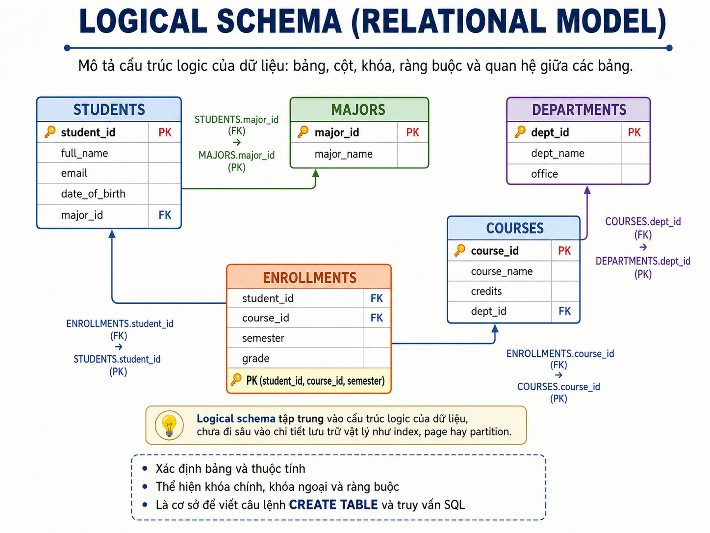
---

## 6. Physical Schema

### 6.1. Mục đích

**Physical schema** mô tả cách DBMS lưu trữ và truy cập dữ liệu thực tế.

Nó có thể gồm:

```text
Indexes
Partitions
Storage engine
File organization
Pages/blocks
Compression
Replication
Access paths
```

### 6.2. Ưu điểm

- Cải thiện hiệu năng cho workload cụ thể.
- Hỗ trợ mở rộng dữ liệu lớn.
- Giúp quản lý storage, backup và recovery.
- Có thể tối ưu truy vấn mà không đổi logical schema.

### 6.3. Hạn chế

- Phụ thuộc DBMS và hạ tầng.
- Tối ưu sai có thể làm write chậm, tăng storage hoặc tăng chi phí vận hành.
- Cần đo workload và theo dõi hiệu năng, không nên dựa vào cảm tính.

### 6.4. Khi điều chỉnh physical schema?

```text
Data volume tăng đáng kể.
Có query chậm lặp lại.
Có workload đọc/ghi thay đổi.
Cần archive hoặc partition dữ liệu theo thời gian.
Cần tăng khả năng phục hồi hoặc availability.
```

> *Hình 4. Physical Schema: Storage, Index và Partition.*


---

## 7. View / External Schema

### 7.1. Mục đích

**View schema** hoặc **external schema** mô tả phần dữ liệu được hiển thị cho một nhóm người dùng hoặc một ứng dụng.

Ví dụ:

| Vai trò | Phần dữ liệu cần thấy |
|---|---|
| Sinh viên | Hồ sơ cá nhân, lịch học, điểm cá nhân |
| Giảng viên | Danh sách lớp, điểm lớp phụ trách |
| Phòng đào tạo | Dữ liệu học vụ rộng hơn |
| Phòng tài chính | Học phí và thanh toán |
| Quản trị viên | Metadata, accounts, permissions, monitoring |

### 7.2. Ưu điểm

- Đơn giản hóa thông tin cho từng vai trò.
- Hỗ trợ least privilege và giảm lộ dữ liệu không cần thiết.
- Giúp giữ interface ổn định khi logical schema thay đổi.
- Hữu ích cho reports, dashboards, APIs và exports.

### 7.3. Hạn chế

- Quá nhiều views có thể khó quản lý.
- View phức tạp có thể tạo vấn đề hiệu năng.
- View không thay thế toàn bộ access-control policy.
- Cần quản lý dependency khi base tables thay đổi.

### 7.4. Khi dùng view schema?

```text
Các nhóm người dùng cần các góc nhìn dữ liệu khác nhau.
Cần che giấu cột nhạy cảm.
Cần tạo báo cáo hoặc API có cấu trúc ổn định.
Cần giảm ảnh hưởng của thay đổi logical schema tới consumers cũ.
```

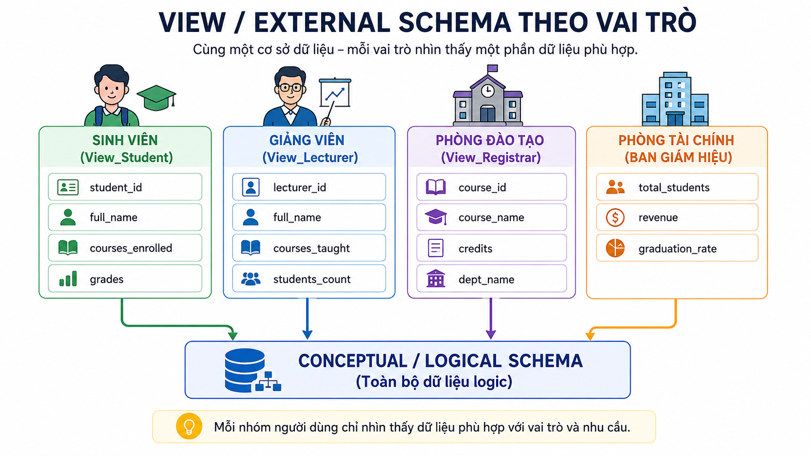
> *Hình 5. View / External Schema theo vai trò.*


---

## 8. So sánh bốn mức schema

| Mức schema | Câu hỏi chính | Mục tiêu chính | Người dùng chính | Rủi ro nếu thiết kế kém |
|---|---|---|---|---|
| Conceptual | Hệ thống cần lưu gì? | Hiểu nghiệp vụ và dữ liệu | Stakeholders, analysts, designers | Thiếu hoặc hiểu sai yêu cầu |
| Logical | Dữ liệu được cấu trúc logic ra sao? | Integrity và tổ chức dữ liệu | Designers, developers, DBA | Dư thừa, quan hệ sai, logic khó mở rộng |
| Physical | Dữ liệu được lưu/truy cập thế nào? | Hiệu năng và storage | DBA, engineers | Query chậm, chi phí cao, khó scale |
| View/External | Ai được thấy dữ liệu nào? | Usability và access scope | Users, applications, analysts | Lộ dữ liệu, interface khó dùng, dependency phức tạp |

---

---

# Phần C. Cơ chế ánh xạ (Mapping) & Tính độc lập dữ liệu (Data Independence)

## 2. Data Independence là gì?

**Data Independence** hay **độc lập dữ liệu** là khả năng thay đổi schema hoặc cách tổ chức dữ liệu ở một mức mà không buộc các mức cao hơn hay các chương trình sử dụng dữ liệu phải thay đổi đáng kể.

Nói cách khác:

```text
Thay đổi cách lưu trữ hoặc tổ chức dữ liệu
→ không nhất thiết làm hỏng application, report, API hoặc user view.
```

Ví dụ:

```text
DBA tạo thêm index để tăng tốc query.
Portal sinh viên vẫn dùng giao diện và truy vấn nghiệp vụ như trước.
```


### 2.1. Lợi ích

- Giảm chi phí bảo trì.
- Hỗ trợ tối ưu hiệu năng mà ít ảnh hưởng ứng dụng.
- Giúp schema phát triển theo yêu cầu nghiệp vụ.
- Hạn chế gián đoạn hệ thống.
- Tăng khả năng tái sử dụng application interfaces.
- Hỗ trợ hệ thống tồn tại lâu dài khi dữ liệu và workload thay đổi.

> Data Independence không phải lời hứa rằng **mọi** thay đổi đều không ảnh hưởng application. Nếu ứng dụng phụ thuộc trực tiếp vào thành phần bị đổi, vẫn cần sửa code hoặc duy trì compatibility layer.


---

### Quiz – Data Independence là gì?

**Câu 1.** Một DBA tạo index mới để tăng tốc tìm đơn hàng, còn ứng dụng không đổi query nghiệp vụ. Điều này phản ánh trực tiếp nhất:

A. Physical Data Independence.
B. Logical Data Independence.
C. External View redesign.
D. Data redundancy.

**Câu 2.** Phát biểu nào về Data Independence là chính xác nhất?

A. Mọi thay đổi schema đều không bao giờ ảnh hưởng application.
B. Data Independence giúp giảm ảnh hưởng của thay đổi, nhưng ứng dụng vẫn có thể cần sửa nếu phụ thuộc trực tiếp vào phần bị đổi.
C. Chỉ có ý nghĩa đối với backup.
D. Chỉ áp dụng cho giao diện web.

**Câu 3.** Mục tiêu chính của Data Independence là gì?

A. Buộc mọi ứng dụng dùng cùng một framework.
B. Loại bỏ hoàn toàn nhu cầu test sau khi schema thay đổi.
C. Giảm sự phụ thuộc giữa các mức dữ liệu và interface sử dụng dữ liệu.
D. Thay thế conceptual schema bằng file vật lý.

## 3. Ôn lại ba mức kiến trúc

```text
View / External Level
        ↑
Logical / Conceptual Level
        ↑
Physical / Internal Level
```

| Mức | Mô tả ngắn |
|---|---|
| Internal | Chi tiết lưu trữ vật lý, file, index, access path |
| Conceptual | Cấu trúc logic tổng thể của database |
| External | Dữ liệu được nhìn thấy qua view, report, form, API hoặc giao diện vai trò |

Data Independence được hỗ trợ bởi các ánh xạ giữa các mức này.


---

### Quiz – Ba mức kiến trúc và mapping

**Câu 1.** Internal–Conceptual Mapping phục vụ trực tiếp nhất cho mục tiêu nào?

A. Cho phép mỗi phòng ban dùng dashboard riêng.
B. Tạo account cho người dùng mới.
C. Mã hóa mật khẩu ở application layer.
D. Ánh xạ cấu trúc logic sang cách lưu trữ vật lý để thay đổi physical organization ít ảnh hưởng conceptual schema.

**Câu 2.** External–Conceptual Mapping quan trọng nhất khi nào?

A. Khi cần duy trì các view/interface phù hợp cho người dùng trong khi conceptual schema có thể tiến hóa.
B. Khi cần thay ổ HDD bằng SSD.
C. Khi cần nén data files.
D. Khi cần chọn page size.

**Câu 3.** Một report cũ tiếp tục hiển thị các cột quen thuộc dù cấu trúc logic bên dưới đã được điều chỉnh. Điều này minh họa tốt nhất cho:

A. Physical partitioning.
B. External–Conceptual Mapping.
C. Index scan.
D. Internal file format.

## 4. Physical Data Independence

### 4.1. Khái niệm

**Physical Data Independence** là khả năng thay đổi internal schema mà không cần thay đổi conceptual schema.

Vì application và external views thường dựa trên conceptual schema hoặc interface ở mức cao hơn, chúng thường không cần thay đổi khi các tối ưu vật lý được thực hiện đúng cách.

### 4.2. Các thay đổi thường gặp

```text
Tạo hoặc thay đổi index
Thay đổi access path
Di chuyển data files
Chuyển dữ liệu từ HDD sang SSD
Nén dữ liệu
Partitioning hoặc reorganization
Thay đổi chiến lược lưu trữ
```

### 4.3. Ví dụ

```sql
CREATE INDEX idx_orders_customer
ON Orders(customer_id);
```

Application vẫn có thể thực hiện:

```sql
SELECT *
FROM Orders
WHERE customer_id = 101;
```

Việc thêm index thay đổi cách DBMS truy cập dữ liệu, nhưng không thay đổi ý nghĩa logic của dữ liệu trong `Orders`.

### 4.4. Internal–Conceptual Mapping

**Internal–Conceptual Mapping** là ánh xạ giữa:

```text
Internal schema
↕
Conceptual schema
```

Vai trò của ánh xạ này:

- DBMS biết cách biểu diễn cấu trúc conceptual bằng các cấu trúc lưu trữ vật lý.
- Khi storage organization thay đổi, DBMS có thể cập nhật mapping nội bộ.
- Conceptual schema và các application dùng nó ít bị ảnh hưởng.


---

### Quiz – Physical Data Independence

**Câu 1.** Thay đổi nào dưới đây thuộc Physical Data Independence rõ nhất?

A. Đổi tên cột `customer_name` thành `full_name`.
B. Tách bảng địa chỉ thành nhiều thành phần logic.
C. Tạo index trên `order_date` và giữ nguyên conceptual schema.
D. Thay đổi API response fields.

**Câu 2.** Vì sao Physical Data Independence thường dễ đạt hơn Logical Data Independence?

A. Vì logical schema không có trong DBMS.
B. Vì physical changes không bao giờ cần kiểm tra.
C. Vì index luôn làm ứng dụng nhanh hơn.
D. Vì thay đổi physical thường được DBMS che giấu tốt hơn khỏi conceptual schema và application.

**Câu 3.** Một tổ chức chuyển dữ liệu lịch sử sang storage tier rẻ hơn, nhưng ứng dụng vẫn truy vấn cùng logical tables. Đây gần nhất là:

A. Physical Data Independence.
B. Logical Data Independence.
C. External schema change.
D. Data duplication.

## 5. Logical Data Independence

### 5.1. Khái niệm

**Logical Data Independence** là khả năng thay đổi conceptual schema mà không buộc external schemas, views hoặc applications phải thay đổi đáng kể.

Đây là mục tiêu khó hơn vì logical schema gần với ý nghĩa dữ liệu mà application đang sử dụng.

### 5.2. Ví dụ thay đổi logic

```text
Thêm thuộc tính mới
Tạo quan hệ mới
Tách một cấu trúc dữ liệu thành nhiều cấu trúc
Gộp nhiều cấu trúc
Đổi tên thuộc tính
Loại bỏ thuộc tính
Thay đổi quy tắc dữ liệu
```

### 5.3. Ví dụ đơn giản

Ban đầu, application cần thông tin nhân viên:

```text
employee_id
full_name
department
```

Sau đó database bổ sung thêm `email`.

```sql
ALTER TABLE Employees
ADD email VARCHAR(100);
```

Nếu application không dùng `SELECT *`, không phụ thuộc vào số lượng cột cố định và không cần trường `email`, application cũ có thể tiếp tục hoạt động.

### 5.4. Compatibility view

Khi logical schema thay đổi, có thể duy trì một view hoặc interface tương thích.

```sql
CREATE VIEW EmployeeBasicView AS
SELECT employee_id,
       full_name,
       department
FROM Employees;
```

Application cũ sử dụng `EmployeeBasicView` có thể tiếp tục nhận tập dữ liệu quen thuộc.

### 5.5. External–Conceptual Mapping

**External–Conceptual Mapping** là ánh xạ giữa:

```text
External schemas / views
↕
Conceptual schema
```

Vai trò:

- Cho phép mỗi nhóm người dùng thấy cấu trúc phù hợp.
- Giúp duy trì interface tương thích khi conceptual schema thay đổi.
- Hỗ trợ giảm tác động của thay đổi logic lên reports, applications và APIs.


---

### Quiz – Logical Data Independence

**Câu 1.** Một ứng dụng dùng `SELECT *` và export CSV có số cột cố định. Khi table được thêm cột, đánh giá nào đúng nhất?

A. Ứng dụng chắc chắn không bị ảnh hưởng.
B. Có thể bị ảnh hưởng, vì nó phụ thuộc trực tiếp vào hình dạng logical schema.
C. Đây chỉ là physical change.
D. DBMS sẽ tự sửa file export.

**Câu 2.** Compatibility view hữu ích nhất trong trường hợp nào?

A. Khi cần tăng dung lượng RAM.
B. Khi cần chọn B+ tree hay hash index.
C. Khi cần giữ interface dữ liệu cũ cho ứng dụng/report trong lúc conceptual schema đã thay đổi.
D. Khi cần sao lưu database.

**Câu 3.** Thay đổi nào có nguy cơ yêu cầu Logical Data Independence hoặc migration plan nhiều nhất?

A. Tạo thêm index cho một cột.
B. Nén data files.
C. Chuyển data files sang SSD.
D. Tách một table đang được nhiều application truy vấn thành các cấu trúc mới.

## 6. So sánh hai loại Data Independence

| Tiêu chí | Physical Data Independence | Logical Data Independence |
|---|---|---|
| Mức thay đổi | Internal schema | Conceptual schema |
| Mức cao hơn cần được bảo vệ | Conceptual schema, external views, applications | External views, applications |
| Ví dụ | Tạo index, đổi storage, nén dữ liệu | Thêm cột, tách/gộp cấu trúc, tạo compatibility view |
| Mục tiêu | Tối ưu lưu trữ và hiệu năng | Cho phép model dữ liệu tiến hóa |
| Độ khó | Thường dễ hơn | Thường khó hơn |
| Rủi ro ảnh hưởng application | Thấp hơn nếu DBMS che giấu tốt | Cao hơn nếu app phụ thuộc trực tiếp schema |

---


---

### Quiz – So sánh hai loại Independence

**Câu 1.** Cặp ghép nào đúng nhất?

A. Physical Independence – thay đổi index/storage; Logical Independence – thay đổi conceptual structure.
B. Physical Independence – thay dashboard; Logical Independence – thay SSD.
C. Physical Independence – đổi API; Logical Independence – đổi page size.
D. Physical Independence – tạo report; Logical Independence – tạo backup.

**Câu 2.** Một team muốn giảm rủi ro khi đổi tên cột đang được nhiều application sử dụng. Giải pháp nào phù hợp nhất?

A. Chỉ thêm index.
B. Duy trì compatibility view hoặc API adapter, công bố lộ trình migration và regression test.
C. Xóa ngay cột cũ mà không thông báo.
D. Chuyển storage sang SSD.

**Câu 3.** Điều nào là kết luận đúng về ảnh hưởng application?

A. Physical changes luôn làm ứng dụng phải sửa.
B. Logical changes không bao giờ ảnh hưởng API hay reports.
C. Physical changes thường ít ảnh hưởng hơn; logical changes cần đánh giá dependency kỹ hơn.
D. Cả hai loại thay đổi luôn có mức rủi ro giống nhau.

## 7. Vì sao Logical Data Independence khó hơn?

Logical changes thường có khả năng ảnh hưởng trực tiếp đến ý nghĩa hoặc hình dạng dữ liệu mà application dùng.

Ví dụ các tình huống rủi ro:

```text
Application dùng SELECT *
ORM mapping phụ thuộc chặt vào schema
Export file yêu cầu cột theo thứ tự cố định
API contract bị thay đổi
Tên cột bị đổi
Một table bị tách thành nhiều table
Quy tắc nghiệp vụ thay đổi ý nghĩa của dữ liệu
```

Do đó, Logical Data Independence thường cần thêm:

```text
Compatibility views
API versioning
Data transformation layer
Migration plan
Regression tests
Deprecation policy
```

---


---

### Quiz – Vì sao Logical Data Independence khó hơn?

**Câu 1.** Lý do nào làm Logical Data Independence khó hơn trong thực tế?

A. DBMS không thể lưu dữ liệu logic.
B. Physical storage không tồn tại.
C. Người dùng cuối luôn quản lý index.
D. Logical changes thường tác động đến tên, cấu trúc hoặc ý nghĩa dữ liệu mà application, report và API đang phụ thuộc.

**Câu 2.** Một migration plan tốt cho thay đổi logical schema nên có nội dung nào?

A. Compatibility layer, kiểm tra dependencies, migration dữ liệu và regression tests.
B. Chỉ cần thay đổi production trực tiếp.
C. Chỉ tạo thêm một index.
D. Chỉ tăng dung lượng storage.

**Câu 3.** Khi một API contract cần duy trì ổn định trong lúc conceptual schema thay đổi, giải pháp nào trực tiếp nhất?

A. Bắt client tự đoán schema mới.
B. Dùng adapter hoặc API versioning để duy trì interface tương thích.
C. Xóa endpoint cũ ngay lập tức.
D. Thay đổi page size của database.

## 7. Vì sao Logical Data Independence khó hơn?

Logical changes thường có khả năng ảnh hưởng trực tiếp đến ý nghĩa hoặc hình dạng dữ liệu mà application dùng.

Ví dụ các tình huống rủi ro:

```text
Application dùng SELECT *
ORM mapping phụ thuộc chặt vào schema
Export file yêu cầu cột theo thứ tự cố định
API contract bị thay đổi
Tên cột bị đổi
Một table bị tách thành nhiều table
Quy tắc nghiệp vụ thay đổi ý nghĩa của dữ liệu
```

Do đó, Logical Data Independence thường cần thêm:

```text
Compatibility views
API versioning
Data transformation layer
Migration plan
Regression tests
Deprecation policy
```

---


---

### Quiz – Vì sao Logical Data Independence khó hơn?

**Câu 1.** Lý do nào làm Logical Data Independence khó hơn trong thực tế?

A. DBMS không thể lưu dữ liệu logic.
B. Physical storage không tồn tại.
C. Người dùng cuối luôn quản lý index.
D. Logical changes thường tác động đến tên, cấu trúc hoặc ý nghĩa dữ liệu mà application, report và API đang phụ thuộc.

**Câu 2.** Một migration plan tốt cho thay đổi logical schema nên có nội dung nào?

A. Compatibility layer, kiểm tra dependencies, migration dữ liệu và regression tests.
B. Chỉ cần thay đổi production trực tiếp.
C. Chỉ tạo thêm một index.
D. Chỉ tăng dung lượng storage.

**Câu 3.** Khi một API contract cần duy trì ổn định trong lúc conceptual schema thay đổi, giải pháp nào trực tiếp nhất?

A. Bắt client tự đoán schema mới.
B. Dùng adapter hoặc API versioning để duy trì interface tương thích.
C. Xóa endpoint cũ ngay lập tức.
D. Thay đổi page size của database.

---

# Phần D. Các mô hình biểu diễn lược đồ (Schema Models)

# Phần B. Mô hình schema và lý do lựa chọn

## 9. Các mô hình schema phổ biến

Các mô hình sau không phải luôn cạnh tranh trực tiếp. Chúng phục vụ các dạng dữ liệu và workload khác nhau:

```text
Flat model
Hierarchical model
Network/graph-oriented model
Relational model
Star schema
Snowflake schema
```

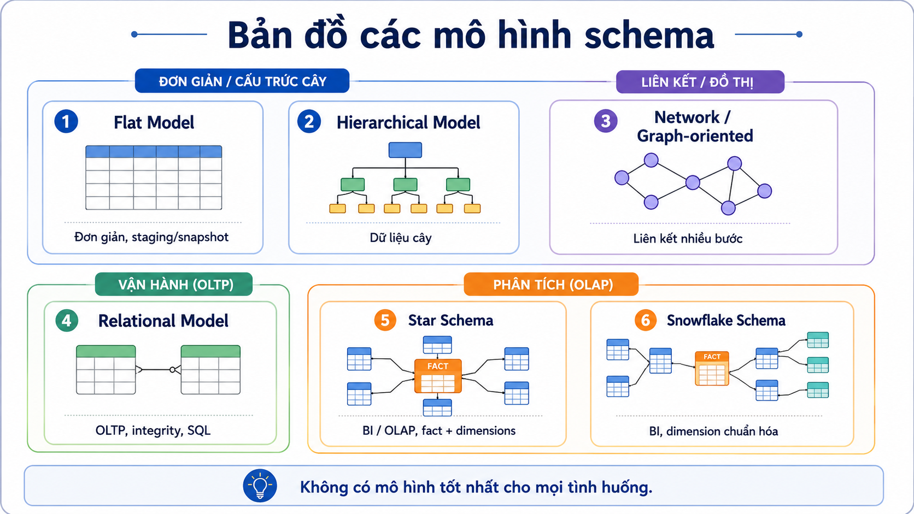
>  *Hình 6. Bản đồ các mô hình schema.*


---

## 10. Flat Model

### 10.1. Đặc điểm

Flat model lưu dữ liệu trong một bảng phẳng hoặc file tabular.

Ví dụ:

```text
StudentID | FullName | Major | AdvisorName | AdvisorEmail
S001      | An       | IS    | Nguyen A    | a@example.edu
```

### 10.2. Ưu điểm

- Dễ hiểu và triển khai nhanh.
- Hợp với danh sách nhỏ, import/export CSV hoặc dữ liệu tạm.
- Ít cần join.
- Phù hợp cho prototype hoặc reporting snapshot đơn giản.

### 10.3. Hạn chế

- Dễ lặp dữ liệu.
- Dễ phát sinh inconsistency khi cùng thông tin được sửa ở nhiều rows.
- Khó biểu diễn many-to-many hoặc dữ liệu có quan hệ phức tạp.
- Khó kiểm soát integrity khi dữ liệu lớn lên.

### 10.4. Khi nên chọn?

```text
Dữ liệu nhỏ.
Quan hệ dữ liệu đơn giản.
Mục đích chính là import/export, staging hoặc snapshot.
Không cần cập nhật nhiều và không cần quản lý quan hệ phức tạp.
```

**Không nên chọn** làm schema vận hành chính khi hệ thống có nhiều thực thể, thay đổi thường xuyên hoặc nhiều quan hệ.

---

## 11. Hierarchical Model

### 11.1. Đặc điểm

Hierarchical model tổ chức dữ liệu theo cây cha–con. Mỗi node con thường có một parent chính.

Ví dụ:

```text
University
├── Faculty
│   ├── Department
│   │   ├── Lecturer
│   │   └── Course
```

### 11.2. Ưu điểm

- Tự nhiên cho dữ liệu có hierarchy cố định.
- Dễ điều hướng theo đường dẫn cha–con.
- Có thể hiệu quả cho các truy vấn dạng subtree.
- Phù hợp với menu, taxonomy, organizational chart hoặc category tree.

### 11.3. Hạn chế

- Không tự nhiên cho many-to-many.
- Khó khi một node cần nhiều parent.
- Thay đổi cấu trúc cây có thể phức tạp.
- Có thể tạo duplication hoặc logic đặc biệt để biểu diễn liên kết chéo.

### 11.4. Khi nên chọn?

```text
Quan hệ chủ yếu là one-to-many.
Cấu trúc có root và hierarchy ổn định.
Truy vấn thường đi từ parent xuống children hoặc ngược lại.
Quan hệ chéo ít quan trọng.
```

---

## 12. Network / Graph-oriented Model

### 12.1. Đặc điểm

Network/graph-oriented model biểu diễn nodes và các liên kết phức tạp. Một node có thể có nhiều parent và nhiều child.

### 12.2. Ưu điểm

- Biểu diễn many-to-many tự nhiên hơn hierarchical model.
- Phù hợp với dữ liệu có nhiều mối liên kết.
- Hỗ trợ các truy vấn traversal nhiều bước.
- Hữu ích khi relationships quan trọng hơn attributes đơn lẻ.

### 12.3. Hạn chế

- Khó hiểu và khó bảo trì nếu link structure phức tạp.
- Coupling cao với cách điều hướng dữ liệu.
- Không phải lựa chọn mặc định cho CRUD business applications.
- Cần cân nhắc graph database hiện đại nếu traversal là workload trung tâm.

### 12.4. Khi nên chọn?

```text
Mối quan hệ là dữ liệu trung tâm.
Có truy vấn nhiều bước theo liên kết.
Ví dụ: recommendation, fraud detection, knowledge graph, social network.
```

---

## 13. Relational Model

### 13.1. Đặc điểm

Relational model tổ chức dữ liệu thành tables có rows và columns, liên kết qua keys và constraints.

### 13.2. Ưu điểm

- Mô hình hóa rõ ràng, trưởng thành và phổ biến.
- Hỗ trợ transactions và integrity constraints tốt.
- SQL mạnh cho CRUD, reporting và joins.
- Hệ sinh thái tooling, backup, security và administration phong phú.
- Phù hợp nhiều hệ thống nghiệp vụ có dữ liệu có cấu trúc.

### 13.3. Hạn chế

- Schema rigidity có thể làm thay đổi cấu trúc cần migration cẩn thận.
- Join nhiều bảng lớn có thể cần thiết kế và indexing tốt.
- Không phải lựa chọn tự nhiên nhất cho graph traversal sâu hoặc document rất biến đổi.
- Scale-out có thể phức tạp hơn trong một số workload cực lớn.

### 13.4. Khi nên chọn?

Relational model thường là lựa chọn khởi đầu hợp lý khi:

```text
Cần giao dịch chính xác.
Có nhiều quy tắc và quan hệ dữ liệu.
Cần báo cáo, joins và SQL.
Cần audit, quyền truy cập và dữ liệu nhất quán.
Hệ thống là ERP, banking, order management, education hoặc HR.
```
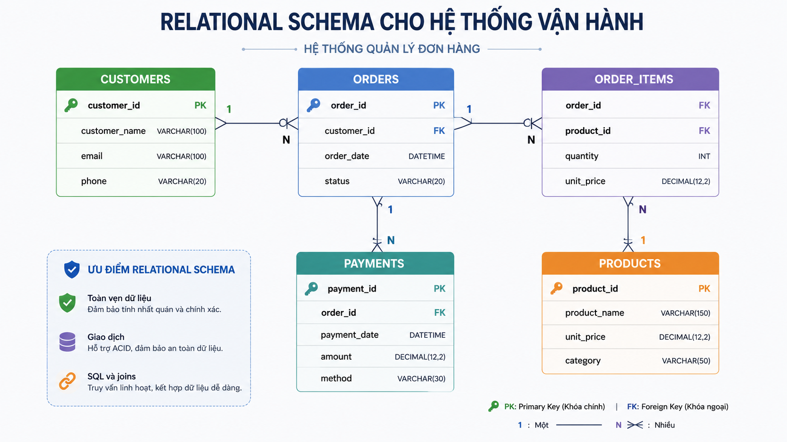
>*Hình 7. Relational Schema cho hệ thống vận hành.*

---

## 14. Star Schema

### 14.1. Đặc điểm

Star schema dùng trong analytics/data warehouse:

```text
Fact table ở trung tâm
Dimension tables kết nối trực tiếp xung quanh
```

Ví dụ:

```text
             DimDate
                |
DimProduct — FactSales — DimCustomer
                |
             DimStore
```

### 14.2. Ưu điểm

- Dễ hiểu với analyst và BI tools.
- Query aggregate thường đơn giản.
- Ít join hơn snowflake schema.
- Phù hợp dashboard, OLAP và báo cáo theo dimensions.
- Dimension denormalized có thể giúp đọc nhanh hơn.

### 14.3. Hạn chế

- Dimension có thể bị lặp dữ liệu.
- Không nên dùng trực tiếp làm schema vận hành cho CRUD transactions.
- Cần ETL/ELT và governance để fact/dimension nhất quán.
- Nếu dimension rất lớn hoặc thay đổi phức tạp, cần thiết kế kỹ.

### 14.4. Khi nên chọn?

```text
Mục tiêu chính là phân tích và reporting.
Queries chủ yếu aggregate theo thời gian, sản phẩm, khách hàng, khu vực.
Người dùng cần hiểu mô hình nhanh.
Ưu tiên tốc độ đọc/dashboard hơn tối ưu hóa cập nhật transactional.
```

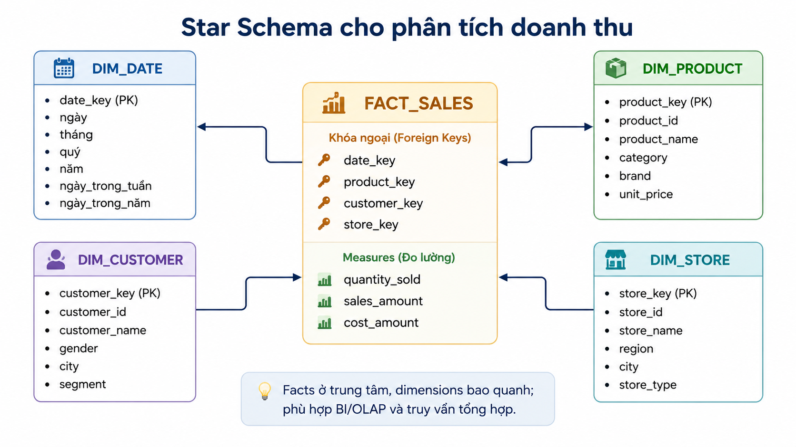

>*Hình 8. Star Schema cho phân tích doanh thu.*

---

## 15. Snowflake Schema

### 15.1. Đặc điểm

Snowflake schema cũng có fact table ở trung tâm nhưng chuẩn hóa dimensions thành nhiều bảng liên quan.

Ví dụ:

```text
FactSales
  ├── DimProduct
  │      ├── DimCategory
  │      └── DimBrand
  ├── DimCustomer
  └── DimDate
```

### 15.2. Ưu điểm

- Giảm redundancy trong dimensions.
- Giúp quản trị các hierarchy dùng chung rõ hơn.
- Hữu ích khi dimension lớn, có nhiều cấp hoặc được tái sử dụng.
- Có thể hỗ trợ data governance tốt hơn cho master data.

### 15.3. Hạn chế

- Nhiều joins hơn star schema.
- Khó hiểu hơn với người mới và analyst.
- BI query có thể phức tạp hơn.
- Tối ưu hiệu năng cần cẩn thận nếu dashboard dày đặc.

### 15.4. Khi nên chọn?

```text
Dimensions có hierarchy phức tạp hoặc dùng chung.
Cần giảm redundancy ở dimensions.
Có yêu cầu governance/master-data rõ.
Team có năng lực quản lý mô hình nhiều tables hơn.
Tăng số joins là trade-off chấp nhận được.
```

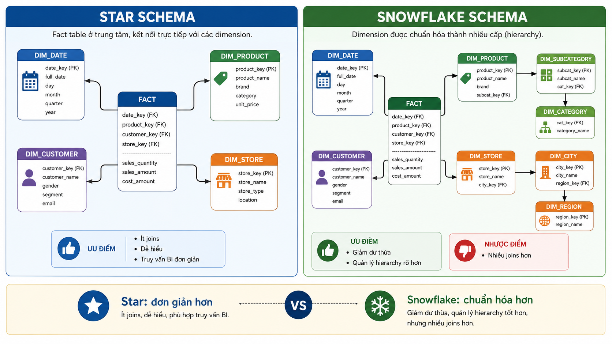

> *Hình 9. So sánh Star Schema và Snowflake Schema.*


---

## 16. Bảng so sánh và chọn schema

| Mô hình | Điểm mạnh | Hạn chế chính | Chọn khi | Không nên chọn khi |
|---|---|---|---|---|
| Flat | Đơn giản, nhanh, ít join | Dễ lặp và sai lệch dữ liệu | Dữ liệu nhỏ, staging, snapshot | Nghiệp vụ nhiều quan hệ/cập nhật |
| Hierarchical | Tự nhiên cho tree | Khó many-to-many | Taxonomy, menu, org chart | Quan hệ chéo phức tạp |
| Network/graph-oriented | Mạnh cho liên kết nhiều bước | Khó quản lý nếu graph phức tạp | Social, fraud, recommendation | CRUD/reporting thông thường |
| Relational | Integrity, transactions, SQL, ecosystem | Migration/join/scale cần thiết kế kỹ | OLTP, nghiệp vụ, reporting có cấu trúc | Graph traversal sâu hoặc schema rất biến đổi |
| Star | Dễ BI/OLAP, đọc aggregate tốt | Redundancy dimension, không phải OLTP model | Warehouse, dashboards | Ghi transaction thường xuyên |
| Snowflake | Giảm redundancy, hierarchy rõ | Nhiều joins, phức tạp hơn | Warehouse với dimensions phức tạp | Dashboard đơn giản cần ít joins |

---

## 17. Khung ra quyết định: tại sao chọn schema này?

Không nên chọn schema chỉ vì “đây là mô hình phổ biến”. Hãy trả lời theo thứ tự.

### 17.1. Workload chính là gì?

```text
OLTP: nhiều insert/update, cần transactions và integrity
OLAP: nhiều aggregate, scan lịch sử, dashboard
Graph traversal: đi theo nhiều tầng quan hệ
Staging/import: xử lý file hoặc dữ liệu tạm
```

### 17.2. Dữ liệu có cấu trúc và quan hệ ra sao?

```text
Mostly tabular, có rules rõ → relational
Tree rõ, parent-child ổn định → hierarchical
Relationships là trung tâm → graph/network-oriented
Facts + dimensions cho analytics → star/snowflake
```

### 17.3. Query pattern nào quan trọng?

```text
Nhiều joins + transactions → relational
Aggregate theo dimensions → star
Dimension hierarchy sâu + governance → snowflake
Traversal nhiều bước → graph-oriented
```

### 17.4. Trade-off nào chấp nhận được?

| Ưu tiên | Hướng lựa chọn thường gặp |
|---|---|
| Data integrity và transactions | Relational |
| Dễ hiểu cho BI users | Star |
| Giảm redundancy dimension | Snowflake |
| Điều hướng parent-child | Hierarchical |
| Phân tích liên kết sâu | Network/graph |
| Đơn giản cho file tạm | Flat |

### 17.5. Câu hỏi kiểm tra cuối

1. Schema có hỗ trợ các query quan trọng nhất không?
2. Schema có kiểm soát được dữ liệu sai hoặc mâu thuẫn không?
3. Team có đủ năng lực vận hành schema này không?
4. Việc mở rộng 12–24 tháng tới có làm schema khó quản lý không?
5. Có cần tách OLTP schema khỏi analytics schema không?

> Một hệ thống lớn thường dùng **nhiều schema cho nhiều mục đích**: relational schema cho vận hành và star/snowflake schema cho warehouse/analytics.

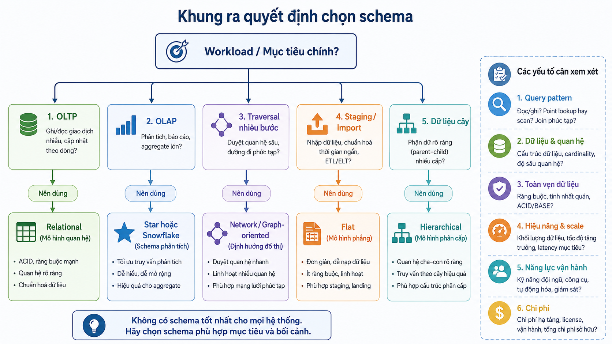
> *Hình 10. Khung ra quyết định chọn schema.*


---

## 17. Khung ra quyết định: tại sao chọn schema này?

Không nên chọn schema chỉ vì “đây là mô hình phổ biến”. Hãy trả lời theo thứ tự.

### 17.1. Workload chính là gì?

```text
OLTP: nhiều insert/update, cần transactions và integrity
OLAP: nhiều aggregate, scan lịch sử, dashboard
Graph traversal: đi theo nhiều tầng quan hệ
Staging/import: xử lý file hoặc dữ liệu tạm
```

### 17.2. Dữ liệu có cấu trúc và quan hệ ra sao?

```text
Mostly tabular, có rules rõ → relational
Tree rõ, parent-child ổn định → hierarchical
Relationships là trung tâm → graph/network-oriented
Facts + dimensions cho analytics → star/snowflake
```

### 17.3. Query pattern nào quan trọng?

```text
Nhiều joins + transactions → relational
Aggregate theo dimensions → star
Dimension hierarchy sâu + governance → snowflake
Traversal nhiều bước → graph-oriented
```

### 17.4. Trade-off nào chấp nhận được?

| Ưu tiên | Hướng lựa chọn thường gặp |
|---|---|
| Data integrity và transactions | Relational |
| Dễ hiểu cho BI users | Star |
| Giảm redundancy dimension | Snowflake |
| Điều hướng parent-child | Hierarchical |
| Phân tích liên kết sâu | Network/graph |
| Đơn giản cho file tạm | Flat |

### 17.5. Câu hỏi kiểm tra cuối

1. Schema có hỗ trợ các query quan trọng nhất không?
2. Schema có kiểm soát được dữ liệu sai hoặc mâu thuẫn không?
3. Team có đủ năng lực vận hành schema này không?
4. Việc mở rộng 12–24 tháng tới có làm schema khó quản lý không?
5. Có cần tách OLTP schema khỏi analytics schema không?

> Một hệ thống lớn thường dùng **nhiều schema cho nhiều mục đích**: relational schema cho vận hành và star/snowflake schema cho warehouse/analytics.


> *Hình 10. Khung ra quyết định chọn schema.*


---

---

# Phần E. Case Study & Vận dụng tổng hợp

## 8. Ví dụ tổng hợp: hệ thống bán hàng

### 8.1. Physical change

DBA thêm index để tối ưu tìm đơn hàng theo khách hàng.

```text
Thay đổi: index/access path
Loại: Physical Data Independence
Application: thường không cần thay đổi
```

### 8.2. Logical change

Hệ thống tách địa chỉ khách hàng thành một cấu trúc riêng để quản lý nhiều địa chỉ.

```text
Thay đổi: conceptual schema
Loại: Logical Data Independence
Application: có thể cần sửa nếu đang đọc trực tiếp cấu trúc cũ
Giảm ảnh hưởng: tạo compatibility view hoặc API adapter
```

### 8.3. Cách đánh giá trước khi thay đổi

1. Thành phần nào đang dùng schema bị thay đổi?
2. Có report, API, ETL hoặc export nào phụ thuộc không?
3. Có thể giữ interface cũ qua view hoặc adapter không?
4. Có cần chạy migration dữ liệu không?
5. Có regression tests cho application không?

---

### Quiz – Quiz tổng hợp

**Câu 1.** Một thay đổi gồm: thêm index, chuyển sang SSD và partition dữ liệu theo ngày. Nếu conceptual schema và API giữ nguyên, đây chủ yếu là:

A. Logical Data Independence.
B. External view redesign.
C. Physical Data Independence.
D. Business rule change.

**Câu 2.** Một thay đổi gồm: tách địa chỉ thành street, city, province, postal_code trong khi dashboard cũ vẫn dùng `full_address`. Cách xử lý phù hợp nhất là:

A. Chỉ thêm index.
B. Chuyển database sang SSD.
C. Bỏ dashboard cũ mà không kiểm tra.
D. Duy trì compatibility view hoặc adapter trả `full_address` trong thời gian chuyển đổi.

**Câu 3.** Dấu hiệu nào cho thấy một thay đổi cần đánh giá Logical Data Independence kỹ hơn?

A. Có reports, APIs, ETL hoặc ORM mappings phụ thuộc trực tiếp vào cấu trúc logic cũ.
B. Thay đổi chỉ liên quan đến access path bên trong DBMS.
C. Thay đổi chỉ di chuyển data files.
D. Chỉ thay đổi cấu hình backup.

**Câu 4.** Phát biểu nào tổng hợp đúng nhất?

A. Physical và Logical Data Independence đều bảo đảm không bao giờ có lỗi.
B. Physical Independence giúp che giấu thay đổi internal; Logical Independence cố gắng che giấu thay đổi conceptual khỏi external consumers.
C. Logical Independence chỉ liên quan đến hardware.
D. Physical Independence chỉ có ý nghĩa với UI.

**Câu 5.** Khi không thể giữ toàn bộ interface cũ, lựa chọn quản trị thay đổi hợp lý nhất là:

A. Thay đổi đột ngột và không kiểm tra.
B. Xóa dữ liệu cũ ngay lập tức.
C. Thông báo deprecation, versioning interface, cung cấp migration guide và kiểm thử.
D. Chỉ thay màu dashboard.

## 10. Bài tập vận dụng

### Bài 10.1. Phân loại thay đổi

Phân loại mỗi thay đổi là Physical hoặc Logical Data Independence, đồng thời giải thích ngắn:

1. Chuyển data files từ HDD sang SSD.
2. Thêm index trên cột `order_date`.
3. Đổi tên cột `customer_name`.
4. Tách địa chỉ giao hàng thành cấu trúc riêng.
5. Nén dữ liệu lịch sử.
6. Tạo view tương thích cho ứng dụng cũ.

### Bài 10.2. Phân tích rủi ro

Một hệ thống đang dùng:

```text
SELECT *
CSV export cố định 8 cột
ORM mapping trực tiếp bảng Customers
Một dashboard dùng view CustomerSummary
```

Nhóm kỹ thuật muốn thêm cột `email_verified`.

Hãy trả lời:

1. Thành phần nào có nguy cơ bị ảnh hưởng?
2. Thay đổi này thuộc physical hay logical?
3. Có thể dùng view hoặc API contract để giảm ảnh hưởng thế nào?
4. Cần test những gì trước khi deploy?

### Bài 10.3. Thiết kế compatibility layer

Một table `Orders` được thay đổi mạnh để hỗ trợ nhiều loại đơn hàng. Hãy đề xuất cách duy trì compatibility cho báo cáo cũ trong một giai đoạn chuyển đổi.

---

---

# Phần F. Tóm tắt & Từ khóa chính

## Tóm tắt nội dung bài học

1. **Kiến trúc ba mức ANSI/SPARC** là nền tảng cốt lõi của mọi hệ quản trị CSDL hiện đại, giải quyết triệt để bài toán phụ thuộc dữ liệu của hệ thống tệp truyền thống.
2. **Ba mức trừu tượng:**
   - **Internal / Physical Level:** Trả lời *"Dữ liệu được lưu trữ như thế nào trên đĩa?"* (file, block, b-tree index, compression). Do DBA và Storage Engine quản lý.
   - **Conceptual / Logical Level:** Trả lời *"Dữ liệu nào được lưu và quan hệ giữa chúng là gì?"* (bảng, cột, khóa chính, khóa ngoại, ràng buộc toàn vẹn). Do Database Designer và Backend Developer quản lý.
   - **External / View Level:** Trả lời *"Người dùng và ứng dụng cần nhìn thấy dữ liệu dưới dạng nào?"* (views, forms, reports, API responses). Phục vụ người dùng cuối và lập trình viên Frontend/API.
3. **Schema vs Instance:**
   - **Schema (Lược đồ):** Là bản vẽ thiết kế cấu trúc, hiếm khi thay đổi.
   - **Instance (Thể hiện / Trạng thái):** Là dữ liệu cụ thể tại một thời điểm, liên tục biến đổi qua các thao tác INSERT/UPDATE/DELETE.
4. **Data Independence (Tính độc lập dữ liệu):**
   - **Physical Data Independence:** Thay đổi ở Physical Schema (thêm index, phân vùng ổ đĩa) không làm thay đổi Conceptual Schema hay mã nguồn ứng dụng.
   - **Logical Data Independence:** Thay đổi ở Conceptual Schema (thêm bảng, tách cột) không làm gián đoạn External Schemas hay ứng dụng cũ nếu dùng view tương thích.
   - **Tính độc lập logic khó hơn nhiều** vì liên quan trực tiếp đến ngữ nghĩa nghiệp vụ và logic truy vấn của ứng dụng.
5. **Mô hình Schema:** Tùy thuộc vào Workload (OLTP cần chuẩn hóa với Relational Model; OLAP cần tối ưu truy vấn tổng hợp với Star/Snowflake Schema).

## Từ khóa chính

- `ANSI/SPARC Architecture`: Kiến trúc 3 mức chuẩn của hệ quản trị CSDL.
- `Internal / Physical Level`: Mức vật lý, lưu trữ thực tế trên thiết bị phần cứng.
- `Conceptual / Logical Level`: Mức quan niệm / logic của toàn bộ CSDL.
- `External / View Level`: Mức ngoài / khung nhìn dành riêng cho từng đối tượng sử dụng.
- `Database Schema`: Lược đồ CSDL (cấu trúc cố định).
- `Database Instance`: Thể hiện CSDL (dữ liệu biến thiên theo thời gian).
- `Internal–Conceptual Mapping`: Ánh xạ vật lý - quan niệm.
- `External–Conceptual Mapping`: Ánh xạ ngoài - quan niệm.
- `Physical Data Independence`: Độc lập dữ liệu vật lý.
- `Logical Data Independence`: Độc lập dữ liệu logic.
- `Compatibility View`: View tương thích giữ giao diện cũ cho ứng dụng khi sửa đổi bảng gốc.
- `Star Schema / Snowflake Schema`: Lược đồ hình sao và bông tuyết dùng trong kho dữ liệu (Data Warehouse).

---

# Đáp án các câu hỏi Quiz

# Đáp án quiz

## Đáp án – Data Abstraction là gì?

| Câu | Đáp án | Giải thích |
|---:|:---:|---|
| 2.1 | A | External Level chỉ đưa ra phần dữ liệu cần thiết; các chi tiết kỹ thuật được che giấu. |
| 2.2 | B | Che giấu thông tin không thay thế xác thực, phân quyền hoặc audit. |
| 2.3 | C | Index và access path thuộc chi tiết nội bộ của DBMS. |

## Đáp án – Ba mức trừu tượng dữ liệu

| Câu | Đáp án | Giải thích |
|---:|:---:|---|
| 3.1 | D | Cấu trúc và quan hệ nghiệp vụ của toàn database thuộc Conceptual Level. |
| 3.2 | A | External trả lời người dùng thấy gì; Conceptual trả lời dữ liệu tổ chức logic ra sao. |
| 3.3 | B | Nhiều external views có thể dựa trên cùng một conceptual model. |

## Đáp án – Physical / Internal Level

| Câu | Đáp án | Giải thích |
|---:|:---:|---|
| 4.1 | C | Data files và index là chi tiết internal. |
| 4.2 | D | Page reads và access path do DBMS quản lý ở mức internal. |
| 4.3 | A | Buộc người dùng chọn cấu trúc lưu trữ làm lộ chi tiết không cần thiết. |

## Đáp án – Logical / Conceptual Level

| Câu | Đáp án | Giải thích |
|---:|:---:|---|
| 5.1 | B | Xác định dữ liệu, ý nghĩa và quan hệ là thiết kế conceptual schema. |
| 5.2 | C | Block trên đĩa là chi tiết physical. |
| 5.3 | D | Conceptual Level cung cấp cấu trúc/ý nghĩa chung cho các view. |

## Đáp án – View / External Level

| Câu | Đáp án | Giải thích |
|---:|:---:|---|
| 6.1 | A | API response là một cách biểu hiện external view. |
| 6.2 | B | External Level rộng hơn SQL VIEW. |
| 6.3 | C | Mỗi vai trò nên có interface/view theo nhiệm vụ và quyền hạn. |

## Đáp án – Quiz tổng hợp

| Câu | Đáp án | Giải thích |
|---:|:---:|---|
| 9.1 | D | Dashboard riêng liên quan External Level, không tự bảo đảm independence. |
| 9.2 | A | Thứ tự từ gần người dùng đến gần lưu trữ là External–Conceptual–Internal. |
| 9.3 | B | Đây là yêu cầu external view và access control theo vai trò. |
| 9.4 | C | Đổi cách lưu trữ mà portal không đổi là Physical Data Independence. |
| 9.5 | D | Ba mức có vai trò riêng nhưng liên kết với nhau. |

# Đáp án quiz

## Đáp án – Schema và Instance

| Câu | Đáp án | Giải thích |
|---:|:---:|---|
| 3.1 | B | Lệnh định nghĩa table là schema, không phải dữ liệu hiện tại. |
| 3.2 | A | Thêm đơn hàng làm thay đổi instance. |
| 3.3 | C | Schema là cấu trúc, còn instance thay đổi theo hoạt động nghiệp vụ. |

## Đáp án – Quiz tổng hợp

| Câu | Đáp án | Giải thích |
|---:|:---:|---|
| 19.1 | B | Hệ thống nghiệp vụ có transactions, rules và relationships thường bắt đầu hợp lý với relational schema. |
| 19.2 | A | Star schema được tối ưu theo hướng phân tích facts qua nhiều dimensions. |
| 19.3 | B | Snowflake giảm redundancy/hỗ trợ hierarchy, đổi lại thường nhiều joins hơn. |
| 19.4 | C | Dữ liệu nhỏ, tạm và đơn giản có thể dùng flat/staging model. |
| 19.5 | B | Cần đánh giá workload; graph model có thể tự nhiên hơn cho traversal sâu. |

# Đáp án quiz

## Đáp án – Data Independence là gì?

| Câu | Đáp án | Giải thích |
|---:|:---:|---|
| 2.1 | A | Thêm index là thay đổi internal/physical. |
| 2.2 | B | Independence giảm ảnh hưởng, không loại bỏ mọi rủi ro phụ thuộc. |
| 2.3 | C | Mục tiêu là giảm coupling giữa các mức và consumers. |

## Đáp án – Ba mức kiến trúc và mapping

| Câu | Đáp án | Giải thích |
|---:|:---:|---|
| 3.1 | D | Internal–Conceptual Mapping che giấu thay đổi physical khỏi conceptual schema. |
| 3.2 | A | External–Conceptual Mapping hỗ trợ external views khi logical schema tiến hóa. |
| 3.3 | B | Report ổn định qua thay đổi logic là ví dụ của mapping External–Conceptual. |

## Đáp án – Physical Data Independence

| Câu | Đáp án | Giải thích |
|---:|:---:|---|
| 4.1 | C | Index là thay đổi physical. |
| 4.2 | D | DBMS thường che giấu thay đổi internal tốt hơn. |
| 4.3 | A | Storage tier là thay đổi physical khi logical tables không đổi. |

## Đáp án – Logical Data Independence

| Câu | Đáp án | Giải thích |
|---:|:---:|---|
| 5.1 | B | SELECT * và CSV fixed schema tạo dependency trực tiếp. |
| 5.2 | C | Compatibility view giữ interface cũ trong khi schema bên dưới thay đổi. |
| 5.3 | D | Tách table có thể phá vỡ nhiều dependencies logic. |

## Đáp án – So sánh hai loại Independence

| Câu | Đáp án | Giải thích |
|---:|:---:|---|
| 6.1 | A | Physical: storage/index; Logical: conceptual structure. |
| 6.2 | B | Compatibility layer và migration/testing phù hợp khi logical interface thay đổi. |
| 6.3 | C | Logical changes thường cần đánh giá dependency kỹ hơn. |

## Đáp án – Vì sao Logical Data Independence khó hơn?

| Câu | Đáp án | Giải thích |
|---:|:---:|---|
| 7.1 | D | Application thường phụ thuộc vào tên/cấu trúc/ý nghĩa dữ liệu. |
| 7.2 | A | Migration plan cần compatibility, dependency analysis và testing. |
| 7.3 | B | Adapter/versioning giúp giữ API contract ổn định. |

## Đáp án – Quiz tổng hợp

| Câu | Đáp án | Giải thích |
|---:|:---:|---|
| 9.1 | C | Index/SSD/partitioning là các thay đổi internal. |
| 9.2 | D | Compatibility view/adapter giữ output `full_address` quen thuộc. |
| 9.3 | A | Dependencies của report/API/ETL/ORM là dấu hiệu logical risk. |
| 9.4 | B | Hai loại independence che giấu thay đổi ở hai ranh giới khác nhau. |
| 9.5 | C | Deprecation, versioning và test giảm rủi ro chuyển đổi. |
